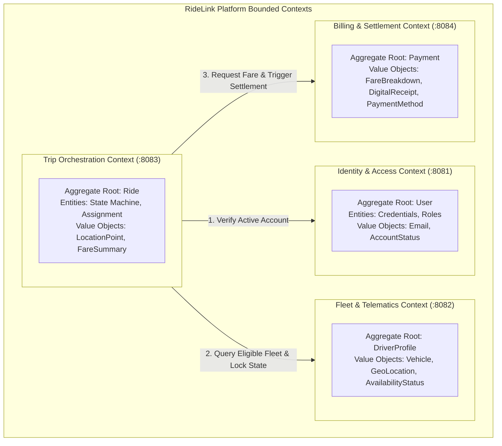
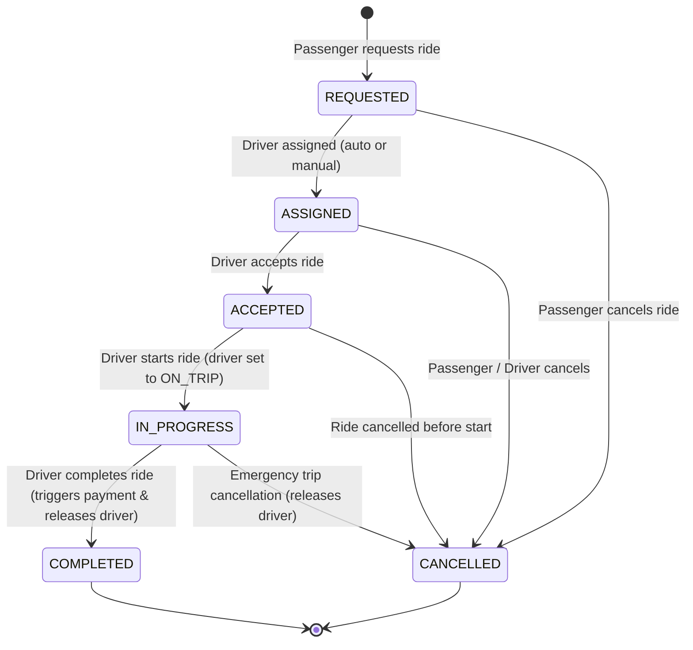
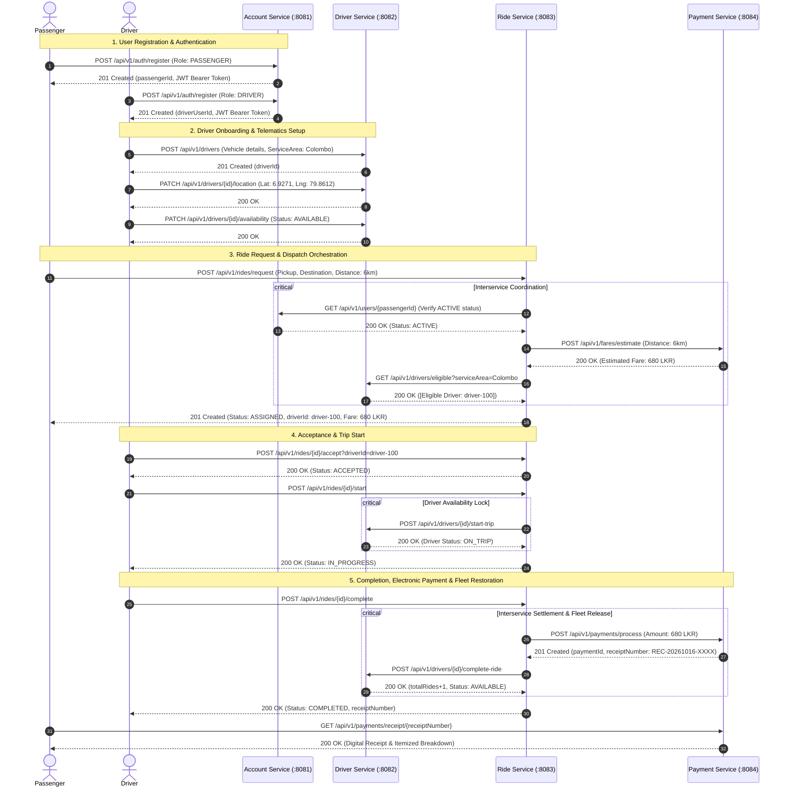
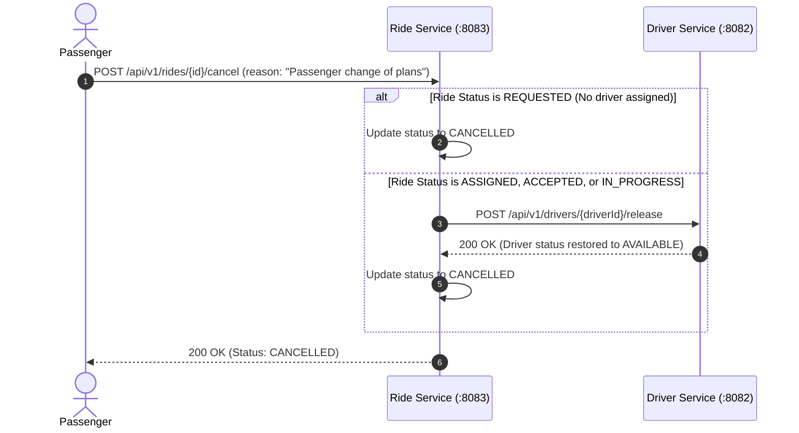
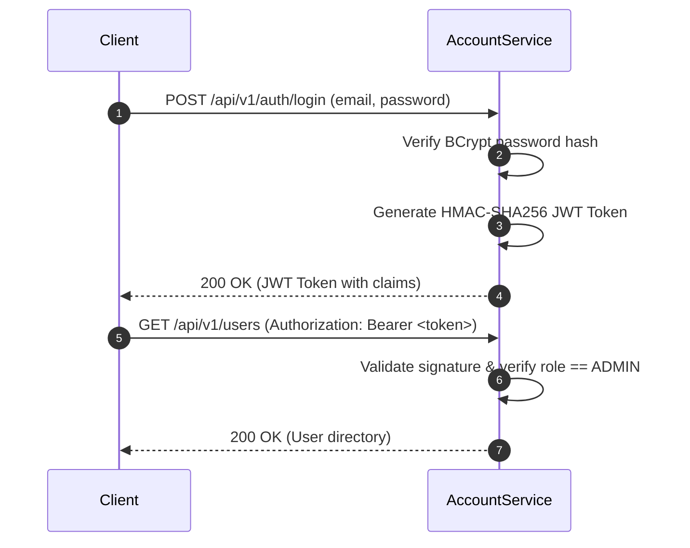
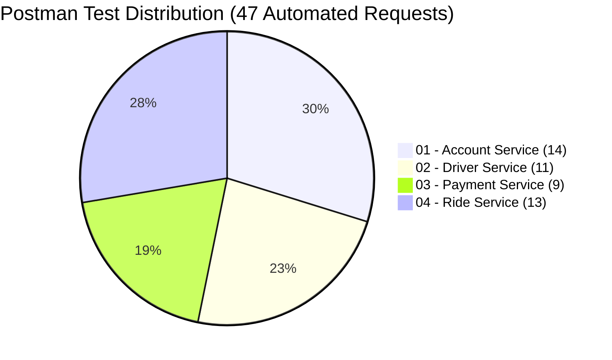
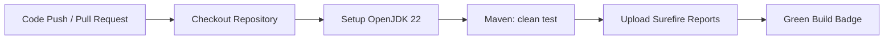

# RideLink — Enterprise Distributed Microservices Platform for On-Demand Ride-Sharing

[](https://openjdk.org/projects/jdk/22/)
[](https://spring.io/projects/spring-boot)
[](https://www.mongodb.com/atlas)
[](https://swagger.io/)
[](https://jwt.io/)
[-brightgreen?style=for-the-badge&logo=junit5&logoColor=white)](https://junit.org/junit5/)
[](https://www.postman.com/)
[](file:///g:/AD%20-%20Ride%20Sharing%20Application%20with%20Microservices/.github/workflows/ci.yml)

---

## Academic & Course Metadata

| Dimension | Details |
| :--- | :--- |
| **Institution** | **Faculty of Computing, Department of Information Technology** |
| **Curriculum Module** | **IT3130 – Application Development (Year 3, Semester 1)** |
| **Assessment Component** | **Group Assignment (30% Weightage)** — Backend Microservices for a Ride-Sharing Platform |
| **Target System** | **RideLink Distributed Cloud-Native Ride-Sharing Platform** |
| **Source Repository** | [Root Reactor Project](file:///g:/AD%20-%20Ride%20Sharing%20Application%20with%20Microservices/pom.xml) |
| **Assignment Specification** | [IT3130_AD_Group_Assignment_RideLink_Student_Release.pdf](file:///g:/AD%20-%20Ride%20Sharing%20Application%20with%20Microservices/IT3130_AD_Group_Assignment_RideLink_Student_Release.pdf) |
| **Comprehensive Technical Report** | [IT3130_RideLink_Technical_Report.md](file:///g:/AD%20-%20Ride%20Sharing%20Application%20with%20Microservices/docs/IT3130_RideLink_Technical_Report.md) |
| **Architecture & Diagrams Reference** | [architecture_and_sequence_diagrams.md](file:///g:/AD%20-%20Ride%20Sharing%20Application%20with%20Microservices/docs/architecture_and_sequence_diagrams.md) |

---

## Table of Contents

1. [Executive Summary & Core Objectives](#1-executive-summary--core-objectives)
2. [Group Organization & Student Ownership Matrix](#2-group-organization--student-ownership-matrix)
3. [Microservices vs. Monolithic Architecture Comparison](#3-microservices-vs-monolithic-architecture-comparison)
4. [Domain-Driven Design (DDD) & Bounded Contexts](#4-domain-driven-design-ddd--bounded-contexts)
5. [Database-per-Service Architecture & MongoDB Atlas Setup](#5-database-per-service-architecture--mongodb-atlas-setup)
6. [System Topology & High-Level Architecture](#6-system-topology--high-level-architecture)
7. [Interservice Communication & Resilient Fallbacks](#7-interservice-communication--resilient-fallbacks)
8. [Ride Lifecycle State Machine (FSM)](#8-ride-lifecycle-state-machine-fsm)
9. [End-to-End Sequence & Workflow Diagrams](#9-end-to-end-sequence--workflow-diagrams)
10. [Comprehensive Microservice Catalog & Deep Dive](#10-comprehensive-microservice-catalog--deep-dive)
    - [10.1 Account & Authentication Service (`account-service` :8081)](#101-account--authentication-service-account-service-8081)
    - [10.2 Driver & Vehicle Service (`driver-service` :8082)](#102-driver--vehicle-service-driver-service-8082)
    - [10.3 Ride Management Service (`ride-service` :8083)](#103-ride-management-service-ride-service-8083)
    - [10.4 Fare & Payment Service (`payment-service` :8084)](#104-fare--payment-service-payment-service-8084)
11. [Transparent Fare Engine & Settlement Protocol](#11-transparent-fare-engine--settlement-protocol)
12. [Security, Authentication & Role-Based Access Control (RBAC)](#12-security-authentication--role-based-access-control-rbac)
13. [Centralized Error Handling & HTTP Status Code Matrix](#13-centralized-error-handling--http-status-code-matrix)
14. [Negative Test Scenarios & Defensive Engineering Checklist](#14-negative-test-scenarios--defensive-engineering-checklist)
15. [Environment Configuration & Variables Reference](#15-environment-configuration--variables-reference)
16. [Local Quickstart & Execution Guide](#16-local-quickstart--execution-guide)
17. [Interactive OpenAPI 3 / Swagger UI Endpoints](#17-interactive-openapi-3--swagger-ui-endpoints)
18. [Postman Integration Test Suite & Automated Runner](#18-postman-integration-test-suite--automated-runner)
19. [Automated Unit Testing & Quality Assurance (53 Tests)](#19-automated-unit-testing--quality-assurance-53-tests)
20. [Continuous Integration (CI/CD) & Git Version Control Practice](#20-continuous-integration-cicd--git-version-control-practice)
21. [Architectural Limitations & Enterprise Scaling Roadmap](#21-architectural-limitations--enterprise-scaling-roadmap)
22. [Project Repository Directory Layout](#22-project-repository-directory-layout)
23. [Academic Compliance & Rubric Criterion Cross-Reference](#23-academic-compliance--rubric-criterion-cross-reference)

---

## 1. Executive Summary & Core Objectives

**RideLink** is a cloud-native, distributed backend platform architected specifically to handle the demands of modern on-demand ride-hailing services. Built using **Java 22** and **Spring Boot 3.3.4**, RideLink replaces monolithic architectures with four loosely coupled, autonomous microservices designed according to the **Database-per-Service** pattern:

- **Account & Authentication Service (`:8081`)**: Manages identity lifecycle, BCrypt credential security, and stateless HMAC-SHA256 JWT token generation and validation.
- **Driver & Vehicle Service (`:8082`)**: Operates fleet compliance, vehicle specifications, real-time simulated driver geolocation updates, and operational availability toggling (`AVAILABLE`, `ON_TRIP`, `OFFLINE`).
- **Ride Management Service (`:8083`)**: Acts as the platform's central domain orchestrator, executing proximity-based driver matching and enforcing a 6-stage finite state machine lifecycle.
- **Fare & Payment Service (`:8084`)**: Provides mathematical fare calculation (base + distance + surge factor), processes mock electronic transactions, supports failure simulations, and mints tamper-evident digital receipts.

### Key Architectural Strengths

1. **Zero Database Coupling**: No microservice has connection credentials or schema knowledge of another service's database.
2. **Synchronous REST with Non-Blocking Fallbacks**: Microservices communicate over HTTP JSON contracts utilizing Spring 6's modern [`RestClient`](file:///g:/AD%20-%20Ride%20Sharing%20Application%20with%20Microservices/ride-service/src/main/java/com/ridelink/ride/config/RestClientConfig.java). Resilient fallbacks prevent cascading failures when downstream services experience latency.
3. **Enterprise Defense-in-Depth**: Strict Role-Based Access Control (`PASSENGER`, `DRIVER`, `ADMIN`), account suspension enforcement, and centralized `@RestControllerAdvice` exception translation.
4. **Verified Software Quality**: Backed by **53 isolated unit tests (100% pass rate)**, a **47-request Postman test suite** with dynamic variable chaining, and automated **GitHub Actions CI**.

---

## 2. Group Organization & Student Ownership Matrix

In compliance with the assignment brief, each team member serves as the dedicated lead architect and developer for one core microservice:

| Student ID | Member Name | Assigned Microservice | Port | MongoDB Atlas Database | Unit Tests | Primary Responsibilities |
| :--- | :--- | :--- | :--- | :--- | :---: | :--- |
| **IT24102280** | **Member 1** | **Account & Authentication Service** | `8081` | `ridelink_account_db` | **21** | User registration (Passenger, Driver, Admin), password hashing (BCrypt), JWT token minting/validation, Role-Based Access Control (`PASSENGER`, `DRIVER`, `ADMIN`), profile management, administrative account suspension (`ACTIVE`, `SUSPENDED`). |
| **IT24104248** | **Member 2** | **Driver & Vehicle Service** | `8082` | `ridelink_driver_db` | **13** | Driver operational profiles, vehicle specifications (make, model, plate, seating, type), operational availability transitions (`AVAILABLE`, `ON_TRIP`, `OFFLINE`), simulated GPS tracking, eligible proximity queries, dispatch lifecycle hooks (`start-trip`, `release`, `complete-ride`). |
| **IT24104016** | **Member 3** | **Ride Management Service** | `8083` | `ridelink_ride_db` | **9** | Core trip orchestration, pickup/destination geolocation modeling, automated proximity driver matching, 6-stage finite state machine lifecycle (`REQUESTED` $\rightarrow$ `ASSIGNED` $\rightarrow$ `ACCEPTED` $\rightarrow$ `IN_PROGRESS` $\rightarrow$ `COMPLETED` / `CANCELLED`), state validation rules, passenger/driver trip histories, resilient interservice fallbacks. |
| **IT24610827** | **Member 4** | **Fare & Payment Service** | `8084` | `ridelink_payment_db` | **10** | Transparent fare estimation formula ($(200 + (\text{km} \times 80)) \times \text{surge}$), simulated payment transaction processing (`CARD`, `CASH`, `WALLET`), payment decline simulation engine (`402 Payment Required`), cryptographic digital receipt issuance (`REC-YYYYMMDD-XXXXXXXX`), payment auditing queries. |

---

## 3. Microservices vs. Monolithic Architecture Comparison

A primary learning objective (LO1) of the IT3130 curriculum is evaluating the trade-offs between monolithic architectures and microservices-based distributed architectures:

| Architectural Dimension | Traditional Monolithic Architecture | RideLink Microservices Architecture |
| :--- | :--- | :--- |
| **Data Boundaries & Coupling** | Single centralized relational database. Tables share foreign keys across users, vehicles, and bookings. Schema alterations frequently cause breaking ripple effects across unrelated modules. | **Strict Database-per-Service**: 4 independent MongoDB databases (`ridelink_account_db`, `ridelink_driver_db`, `ridelink_ride_db`, `ridelink_payment_db`). Zero direct database cross-talk; communication strictly occurs via versioned REST APIs. |
| **Blast Radius & Fault Isolation** | High failure risk. A memory leak in payment receipt rendering or an unindexed query in user search can exhaust the shared thread pool, crashing the entire monolith. | **Decoupled Failure Domains**: Downstream crashes are isolated. If the Payment Service experiences temporary downtime, the Ride Service leverages an in-memory pricing fallback to preserve booking availability. |
| **Targeted Horizontal Scalability** | The entire monolith must be scaled uniformly. Peak rush-hour traffic on driver matching forces unnecessary scaling of idle account registration services, wasting compute. | **Targeted Scaling**: High-throughput components ([`ride-service`](file:///g:/AD%20-%20Ride%20Sharing%20Application%20with%20Microservices/ride-service) and [`driver-service`](file:///g:/AD%20-%20Ride%20Sharing%20Application%20with%20Microservices/driver-service)) can be scaled independently on container clusters based on traffic density. |
| **Development Autonomy (Conway's Law)** | Engineers share a single monolithic codebase. Frequent Git merge conflicts, shared configuration files, and coordinated deployment lock-in impede team release cadence. | **Total Service Ownership**: Each microservice operates within its own module and Git branch. Team members develop, refactor, test, and package their domain services independently. |
| **Deployment Independence** | A single bug fix in fare calculation requires recompilation, end-to-end regression testing, and deployment of the entire platform, creating downtime windows. | **Zero-Downtime Rolling Releases**: Individual JARs can be rebuilt, containerized, and deployed without restarting or disrupting unaffected microservices. |
| **Technology Stack Agility** | Locked into a single language and framework stack for the entire application lifetime. | **Polyglot Extensibility**: While Spring Boot 3.3.4 is the standard across RideLink, individual components can evolve independently (e.g., driver location tracking transitioning to Redis/Go). |

---

## 4. Domain-Driven Design (DDD) & Bounded Contexts

RideLink's microservice boundaries are modeled using tactical **Domain-Driven Design (DDD)** concepts:



1. **Identity & Access Management Bounded Context ([`account-service`](file:///g:/AD%20-%20Ride%20Sharing%20Application%20with%20Microservices/account-service))**:
   - **Aggregate Root**: [`User`](file:///g:/AD%20-%20Ride%20Sharing%20Application%20with%20Microservices/account-service/src/main/java/com/ridelink/account/model/User.java)
   - **Enums & Value Objects**: [`Role`](file:///g:/AD%20-%20Ride%20Sharing%20Application%20with%20Microservices/account-service/src/main/java/com/ridelink/account/model/Role.java) (`PASSENGER`, `DRIVER`, `ADMIN`), [`AccountStatus`](file:///g:/AD%20-%20Ride%20Sharing%20Application%20with%20Microservices/account-service/src/main/java/com/ridelink/account/model/AccountStatus.java) (`ACTIVE`, `SUSPENDED`)
   - **Responsibilities**: User profile management, password encryption, token minting, token verification.

2. **Fleet Operations & Telematics Bounded Context ([`driver-service`](file:///g:/AD%20-%20Ride%20Sharing%20Application%20with%20Microservices/driver-service))**:
   - **Aggregate Root**: [`DriverProfile`](file:///g:/AD%20-%20Ride%20Sharing%20Application%20with%20Microservices/driver-service/src/main/java/com/ridelink/driver/model/DriverProfile.java)
   - **Enums & Value Objects**: [`AvailabilityStatus`](file:///g:/AD%20-%20Ride%20Sharing%20Application%20with%20Microservices/driver-service/src/main/java/com/ridelink/driver/model/AvailabilityStatus.java) (`AVAILABLE`, `ON_TRIP`, `OFFLINE`), [`Location`](file:///g:/AD%20-%20Ride%20Sharing%20Application%20with%20Microservices/driver-service/src/main/java/com/ridelink/driver/model/Location.java), [`Vehicle`](file:///g:/AD%20-%20Ride%20Sharing%20Application%20with%20Microservices/driver-service/src/main/java/com/ridelink/driver/model/Vehicle.java), [`VehicleType`](file:///g:/AD%20-%20Ride%20Sharing%20Application%20with%20Microservices/driver-service/src/main/java/com/ridelink/driver/model/VehicleType.java)
   - **Responsibilities**: Vehicle compliance, driver availability transitions, geographic proximity queries, driver performance metrics (`totalRidesCompleted`).

3. **Trip Orchestration Bounded Context ([`ride-service`](file:///g:/AD%20-%20Ride%20Sharing%20Application%20with%20Microservices/ride-service))**:
   - **Aggregate Root**: [`Ride`](file:///g:/AD%20-%20Ride%20Sharing%20Application%20with%20Microservices/ride-service/src/main/java/com/ridelink/ride/model/Ride.java)
   - **Enums & Value Objects**: [`RideStatus`](file:///g:/AD%20-%20Ride%20Sharing%20Application%20with%20Microservices/ride-service/src/main/java/com/ridelink/ride/model/RideStatus.java) (`REQUESTED`, `ASSIGNED`, `ACCEPTED`, `IN_PROGRESS`, `COMPLETED`, `CANCELLED`), [`LocationPoint`](file:///g:/AD%20-%20Ride%20Sharing%20Application%20with%20Microservices/ride-service/src/main/java/com/ridelink/ride/model/LocationPoint.java)
   - **Responsibilities**: Booking coordination, nearest driver selection, state machine transitions, cancellation handling.

4. **Billing & Settlement Bounded Context ([`payment-service`](file:///g:/AD%20-%20Ride%20Sharing%20Application%20with%20Microservices/payment-service))**:
   - **Aggregate Root**: [`Payment`](file:///g:/AD%20-%20Ride%20Sharing%20Application%20with%20Microservices/payment-service/src/main/java/com/ridelink/payment/model/Payment.java)
   - **Enums & Value Objects**: [`PaymentStatus`](file:///g:/AD%20-%20Ride%20Sharing%20Application%20with%20Microservices/payment-service/src/main/java/com/ridelink/payment/model/PaymentStatus.java) (`PENDING`, `COMPLETED`, `FAILED`), [`PaymentMethod`](file:///g:/AD%20-%20Ride%20Sharing%20Application%20with%20Microservices/payment-service/src/main/java/com/ridelink/payment/model/PaymentMethod.java) (`CARD`, `CASH`, `WALLET`), Digital Receipt formatting
   - **Responsibilities**: Fare calculation algorithms, electronic payment simulation, failure simulation, digital receipt issuance.

---

## 5. Database-per-Service Architecture & MongoDB Atlas Setup

Each microservice communicates exclusively with its own isolated database namespace hosted on MongoDB Atlas (or local MongoDB):

```text
+------------------------------------+---------------------------------------+
| Microservice                       | Isolated MongoDB Database Namespace   |
+------------------------------------+---------------------------------------+
| Account Service (:8081)            | ridelink_account_db (collection: users)|
| Driver Service  (:8082)            | ridelink_driver_db  (collection: drivers)|
| Ride Service    (:8083)            | ridelink_ride_db    (collection: rides)|
| Payment Service (:8084)            | ridelink_payment_db (collection: payments)|
+------------------------------------+---------------------------------------+
```

### Connection Configuration Options

RideLink supports two flexible database connection strategies via environment variables:

#### Option A: Unified Cluster URI (Default Setup)

Point all services to a single MongoDB Atlas cluster. Each service automatically binds to its dedicated database name:

```bash
MONGODB_URI=mongodb+srv://<username>:<password>@ridelink-db.c3duzqw.mongodb.net/?retryWrites=true&w=majority
```

#### Option B: Role-Restricted Atlas Users (Lecturer Recommendation)

Create distinct MongoDB Atlas database users with read/write privileges strictly limited to individual database namespaces:

```bash
ACCOUNT_MONGODB_URI=mongodb+srv://account-user:<password>@ridelink-db.c3duzqw.mongodb.net/ridelink_account_db?retryWrites=true&w=majority
DRIVER_MONGODB_URI=mongodb+srv://driver-user:<password>@ridelink-db.c3duzqw.mongodb.net/ridelink_driver_db?retryWrites=true&w=majority
RIDE_MONGODB_URI=mongodb+srv://ride-user:<password>@ridelink-db.c3duzqw.mongodb.net/ridelink_ride_db?retryWrites=true&w=majority
PAYMENT_MONGODB_URI=mongodb+srv://payment-user:<password>@ridelink-db.c3duzqw.mongodb.net/ridelink_payment_db?retryWrites=true&w=majority
```

---

## 6. System Topology & High-Level Architecture

The following diagram illustrates the interaction boundaries, ingress ports, client interfaces, and internal persistence layers:

```mermaid
graph TD
    Client["Client Layer\n(Swagger UI / Postman / Frontend App)"]

    subgraph Cluster ["RideLink Microservices Ecosystem"]
        subgraph S1 ["Account Service (:8081)\nMember 1 - IT24102280"]
            AC_Ctrl["AuthController & UserController"]
            AC_Svc["AuthService & UserService"]
            AC_DB[("MongoDB Atlas\nridelink_account_db")]
            AC_Ctrl --> AC_Svc --> AC_DB
        end

        subgraph S2 ["Driver & Vehicle Service (:8082)\nMember 2 - IT24104248"]
            DR_Ctrl["DriverController"]
            DR_Svc["DriverService"]
            DR_DB[("MongoDB Atlas\nridelink_driver_db")]
            DR_Ctrl --> DR_Svc --> DR_DB
        end

        subgraph S3 ["Ride Management Service (:8083)\nMember 3 - IT24104016"]
            RD_Ctrl["RideController"]
            RD_Svc["RideService"]
            RD_DB[("MongoDB Atlas\nridelink_ride_db")]
            RD_Ctrl --> RD_Svc --> RD_DB
        end

        subgraph S4 ["Fare & Payment Service (:8084)\nMember 4 - IT24610827"]
            PM_Ctrl["FareController & PaymentController"]
            PM_Svc["FareService & PaymentService"]
            PM_DB[("MongoDB Atlas\nridelink_payment_db")]
            PM_Ctrl --> PM_Svc --> PM_DB
        end
    end

    %% Client Ingress
    Client -->|REST JSON| AC_Ctrl
    Client -->|REST JSON| DR_Ctrl
    Client -->|REST JSON| RD_Ctrl
    Client -->|REST JSON| PM_Ctrl

    %% Synchronous Interservice Communications
    RD_Svc -->|1. GET /api/v1/users/{id} (Check ACTIVE)| AC_Ctrl
    RD_Svc -->|2. POST /api/v1/fares/estimate| PM_Ctrl
    RD_Svc -->|3. GET /api/v1/drivers/eligible| DR_Ctrl
    RD_Svc -->|4. POST /api/v1/drivers/{id}/start-trip| DR_Ctrl
    RD_Svc -->|5. POST /api/v1/payments/process| PM_Ctrl
    RD_Svc -->|6. POST /api/v1/drivers/{id}/complete-ride| DR_Ctrl
    RD_Svc -->|7. POST /api/v1/drivers/{id}/release| DR_Ctrl
```

---

## 7. Interservice Communication & Resilient Fallbacks

### Synchronous REST vs. Asynchronous Messaging Evaluation (LO2)

| Criteria | Synchronous REST (`RestClient`) | Asynchronous Event-Driven (RabbitMQ / Kafka) |
| :--- | :--- | :--- |
| **Communication Pattern** | Request-Response RPC over HTTP/1.1 or HTTP/2. The caller blocks until a response is received or timeout triggers. | Publish-Subscribe or Message Queuing. Producers publish messages to an exchange; consumers pull asynchronously. |
| **Suitability for Ride Dispatching** | **Optimal for Real-Time Dispatch**: The passenger UI expects immediate confirmation of fare estimate and assigned driver ID upon submission. | Suboptimal for immediate booking replies. Requires WebSockets, SSE, or polling to notify client of dispatch outcome. |
| **Temporal Coupling** | High temporal coupling. Both services must be online simultaneously. | Complete temporal decoupling. Messages persist in brokers if consumers are offline. |
| **Operational Simplicity** | Very high. Standard HTTP endpoints; no external broker daemons, cluster quorum, or topic partition tuning. | Demands significant infrastructure overhead: broker management, consumer groups, dead-letter queues (DLQ), and idempotent receivers. |
| **Cascade Failure Risk** | Risk of thread starvation if downstreams hang without timeout/fallback policies. | Low cascade risk; downstream downtime does not block message publication. |
| **RideLink Implementation** | **Adopted as Core**: Implemented with Spring 6 `RestClient`, custom connection timeouts, and programmatic fallback handlers. | **Roadmap Feature**: Retained for asynchronous background operations (e.g., push notifications, email receipts, driver analytics). |

### Interservice Integration & Fallback Matrix

The Ride Management Service implements defensive fallbacks to maintain system availability during downstream service disruptions:

| Downstream Target Service | Target Endpoint Invocation | Purpose in Workflow | Resilient Fallback Strategy |
| :--- | :--- | :--- | :--- |
| **Account Service (`:8081`)** | `GET /api/v1/users/{passengerId}` | Verify that the passenger account is `ACTIVE` and not `SUSPENDED`. | If Account Service is unreachable, [`AccountServiceClient`](file:///g:/AD%20-%20Ride%20Sharing%20Application%20with%20Microservices/ride-service/src/main/java/com/ridelink/ride/client/AccountServiceClient.java) logs a warning and permits the ride request to avoid stranding legitimate users during auth downtime. |
| **Fare & Payment Service (`:8084`)** | `POST /api/v1/fares/estimate` | Obtain dynamic fare estimate based on distance and current surge. | If Payment Service times out, [`PaymentServiceClient`](file:///g:/AD%20-%20Ride%20Sharing%20Application%20with%20Microservices/ride-service/src/main/java/com/ridelink/ride/client/PaymentServiceClient.java) uses an internal fallback formula: $\text{Fare} = 200.00 + (\text{distanceKm} \times 80.00) \text{ LKR}$. |
| **Driver Service (`:8082`)** | `GET /api/v1/drivers/eligible?serviceArea=Colombo` | Query nearest available driver matching the requested pickup location. | If no drivers are available or the Driver Service is unreachable, the ride transitions gracefully to `REQUESTED` with `driverId: null` rather than throwing an exception. |
| **Driver Service (`:8082`)** | `POST /api/v1/drivers/{id}/start-trip` | Lock driver availability to `ON_TRIP` when ride starts. | Prevents driver from being double-dispatched to concurrent ride requests. |
| **Driver Service (`:8082`)** | `POST /api/v1/drivers/{id}/complete-ride` | Restore driver status to `AVAILABLE` and increment `totalRidesCompleted`. | Seamless fleet state cleanup after trip completion. |
| **Driver Service (`:8082`)** | `POST /api/v1/drivers/{id}/release` | Restore driver status to `AVAILABLE` without incrementing rides on cancellation. | Protects driver performance statistics and frees vehicle for subsequent dispatch. |
| **Fare & Payment Service (`:8084`)** | `POST /api/v1/payments/process` | Automatically charge passenger and generate digital receipt upon ride completion. | Returns generated `paymentId` and `receiptNumber` attached directly to the completed ride record. |

---

## 8. Ride Lifecycle State Machine (FSM)

The Ride Management Service strictly enforces a 6-stage finite state machine. Illegal state transitions are rejected with HTTP `400 BAD REQUEST`:



### Valid vs. Invalid State Transitions

| Starting State | Trigger Endpoint | Allowed Next State | Action / Side Effect |
| :--- | :--- | :--- | :--- |
| **`REQUESTED`** | `POST /rides/{id}/assign` | **`ASSIGNED`** | Binds driver ID to ride record. |
| **`REQUESTED`** | `POST /rides/{id}/cancel` | **`CANCELLED`** | Ride cancelled with documented reason; no driver to release. |
| **`ASSIGNED`** | `POST /rides/{id}/accept` | **`ACCEPTED`** | Validates driver match; confirms driver commitment. |
| **`ASSIGNED`** | `POST /rides/{id}/cancel` | **`CANCELLED`** | Calls Driver Service to release driver back to `AVAILABLE`. |
| **`ACCEPTED`** | `POST /rides/{id}/start` | **`IN_PROGRESS`** | Locks assigned driver status to `ON_TRIP`. |
| **`ACCEPTED`** | `POST /rides/{id}/cancel` | **`CANCELLED`** | Calls Driver Service to release driver back to `AVAILABLE`. |
| **`IN_PROGRESS`** | `POST /rides/{id}/complete` | **`COMPLETED`** | Initiates simulated payment settlement; increments driver completed rides; sets driver `AVAILABLE`. |
| **`IN_PROGRESS`** | `POST /rides/{id}/cancel` | **`CANCELLED`** | Releases driver back to `AVAILABLE`. |
| **`COMPLETED`** | *Any modification attempt* | **REJECTED (400)** | Completed rides are immutable. Attempting to start or cancel returns `InvalidRideStateException`. |
| **`CANCELLED`** | *Any modification attempt* | **REJECTED (400)** | Cancelled rides cannot be restarted, accepted, or re-cancelled. |

---

## 9. End-to-End Sequence & Workflow Diagrams

### 9.1 End-to-End Complete Ride Workflow (Happy Path)



### 9.2 Alternative Flow: Ride Cancellation & Driver Restoration



---

## 10. Comprehensive Microservice Catalog & Deep Dive

---

### 10.1 Account & Authentication Service (`account-service` :8081)

- **Primary Owner**: Member 1 (`IT24102280`)
- **Port**: `8081` | **Context Path**: `/api/v1/auth`, `/api/v1/users`
- **Database**: MongoDB Atlas (`ridelink_account_db` / `users` collection)
- **Source Package**: [`com.ridelink.account`](file:///g:/AD%20-%20Ride%20Sharing%20Application%20with%20Microservices/account-service/src/main/java/com/ridelink/account)

#### Account Service Architecture & Design Highlights

- **Password Security**: Salted hashing via Spring Security's [`BCryptPasswordEncoder`](file:///g:/AD%20-%20Ride%20Sharing%20Application%20with%20Microservices/account-service/src/main/java/com/ridelink/account/config/SecurityBeansConfig.java) with a strength factor of 10. Plaintext passwords are never stored.
- **Stateless Tokens**: Mints standard JWT tokens with HMAC-SHA256 signatures via [`JwtTokenProvider`](file:///g:/AD%20-%20Ride%20Sharing%20Application%20with%20Microservices/account-service/src/main/java/com/ridelink/account/security/JwtTokenProvider.java).
- **Role-Based Protection**: Administrative endpoints require the `ADMIN` role, enforced through header/token inspection.
- **Account Status**: Manages `ACTIVE` and `SUSPENDED` user states. Suspended users cannot log in or request rides.

#### Account Service API Endpoints Reference

| HTTP Method | Route | Description | Auth Required | Request Body | Success Status |
| :--- | :--- | :--- | :---: | :--- | :---: |
| `POST` | `/api/v1/auth/register` | Register new Passenger, Driver, or Admin account | No | [`RegisterRequest`](file:///g:/AD%20-%20Ride%20Sharing%20Application%20with%20Microservices/account-service/src/main/java/com/ridelink/account/dto/RegisterRequest.java) | `201 CREATED` |
| `POST` | `/api/v1/auth/login` | Authenticate user credentials and return JWT token | No | [`LoginRequest`](file:///g:/AD%20-%20Ride%20Sharing%20Application%20with%20Microservices/account-service/src/main/java/com/ridelink/account/dto/LoginRequest.java) | `200 OK` |
| `POST` | `/api/v1/auth/validate` | Verify JWT token signature, expiration & account status | No | [`TokenValidationRequest`](file:///g:/AD%20-%20Ride%20Sharing%20Application%20with%20Microservices/account-service/src/main/java/com/ridelink/account/dto/TokenValidationRequest.java) | `200 OK` |
| `GET` | `/api/v1/users/{id}` | Retrieve user profile by user ID | No | *None* | `200 OK` |
| `GET` | `/api/v1/users` | List all platform users | **Yes (`ADMIN`)** | *None* | `200 OK` |
| `PUT` | `/api/v1/users/{id}` | Update name and phone number | No | [`UpdateProfileRequest`](file:///g:/AD%20-%20Ride%20Sharing%20Application%20with%20Microservices/account-service/src/main/java/com/ridelink/account/dto/UpdateProfileRequest.java) | `200 OK` |
| `PATCH` | `/api/v1/users/{id}/status` | Administrative account status update (`ACTIVE`/`SUSPENDED`) | **Yes (`ADMIN`)** | [`UpdateStatusRequest`](file:///g:/AD%20-%20Ride%20Sharing%20Application%20with%20Microservices/account-service/src/main/java/com/ridelink/account/dto/UpdateStatusRequest.java) | `200 OK` |

#### Account Service Sample Request & Response

```bash
curl -X POST http://localhost:8081/api/v1/auth/register \
  -H "Content-Type: application/json" \
  -d '{
    "name": "Kamal Perera",
    "email": "kamal@gmail.com",
    "password": "SecurePassword123!",
    "phone": "+94771234567",
    "role": "PASSENGER"
  }'
```

```json
{
  "token": "eyJhbGciOiJIUzI1NiJ9.eyJzdWIiOiI2NmZhMm...",
  "userId": "66fa2b87e4b0c921a987ef12",
  "name": "Kamal Perera",
  "email": "kamal@gmail.com",
  "role": "PASSENGER",
  "status": "ACTIVE"
}
```

---

### 10.2 Driver & Vehicle Service (`driver-service` :8082)

- **Primary Owner**: Member 2 (`IT24104248`)
- **Port**: `8082` | **Context Path**: `/api/v1/drivers`
- **Database**: MongoDB Atlas (`ridelink_driver_db` / `drivers` collection)
- **Source Package**: [`com.ridelink.driver`](file:///g:/AD%20-%20Ride%20Sharing%20Application%20with%20Microservices/driver-service/src/main/java/com/ridelink/driver)

#### Driver Service Architecture & Design Highlights

- **Fleet Onboarding**: Binds registered driver accounts to vehicle records (license plate, make, model, color, seating capacity, vehicle type).
- **Availability State Machine**: Governs driver readiness:
  - `AVAILABLE`: Ready for trip dispatch.
  - `ON_TRIP`: Locked in an active trip; excluded from eligible driver queries.
  - `OFFLINE`: Driver is off-duty.
- **Simulated Telematics**: Stores and updates simulated GPS latitude/longitude and physical address.
- **Proximity Matching**: Provides `GET /api/v1/drivers/eligible` supporting geographic filtering by `serviceArea` and availability.
- **Lifecycle Hooks**: Exposes dedicated interservice endpoints (`/start-trip`, `/release`, `/complete-ride`) invoked by Ride Service.

#### Driver Service API Endpoints Reference

| HTTP Method | Route | Description | Request Body | Success Status |
| :--- | :--- | :--- | :--- | :---: |
| `POST` | `/api/v1/drivers` | Create driver operational profile & register vehicle | [`CreateDriverProfileRequest`](file:///g:/AD%20-%20Ride%20Sharing%20Application%20with%20Microservices/driver-service/src/main/java/com/ridelink/driver/dto/CreateDriverProfileRequest.java) | `201 CREATED` |
| `GET` | `/api/v1/drivers/{id}` | Retrieve driver profile by driver ID | *None* | `200 OK` |
| `GET` | `/api/v1/drivers/user/{userId}` | Retrieve operational profile by Account Service user ID | *None* | `200 OK` |
| `GET` | `/api/v1/drivers` | List all registered drivers | *None* | `200 OK` |
| `PATCH` | `/api/v1/drivers/{id}/availability` | Toggle status (`AVAILABLE`, `ON_TRIP`, `OFFLINE`) | [`UpdateAvailabilityRequest`](file:///g:/AD%20-%20Ride%20Sharing%20Application%20with%20Microservices/driver-service/src/main/java/com/ridelink/driver/dto/UpdateAvailabilityRequest.java) | `200 OK` |
| `PATCH` | `/api/v1/drivers/{id}/location` | Update simulated GPS latitude, longitude & address | [`UpdateLocationRequest`](file:///g:/AD%20-%20Ride%20Sharing%20Application%20with%20Microservices/driver-service/src/main/java/com/ridelink/driver/dto/UpdateLocationRequest.java) | `200 OK` |
| `PUT` | `/api/v1/drivers/{id}/vehicle` | Update vehicle specifications | [`UpdateVehicleRequest`](file:///g:/AD%20-%20Ride%20Sharing%20Application%20with%20Microservices/driver-service/src/main/java/com/ridelink/driver/dto/UpdateVehicleRequest.java) | `200 OK` |
| `GET` | `/api/v1/drivers/eligible` | Query available eligible drivers by service area | *QueryParams: serviceArea, lat, lng* | `200 OK` |
| `POST` | `/api/v1/drivers/{id}/start-trip` | Interservice hook: Transition driver status to `ON_TRIP` | *None* | `204 NO CONTENT` |
| `POST` | `/api/v1/drivers/{id}/release` | Interservice hook: Restore status to `AVAILABLE` (on cancel) | *None* | `204 NO CONTENT` |
| `POST` | `/api/v1/drivers/{id}/complete-ride` | Interservice hook: Increment total rides & set `AVAILABLE` | *None* | `204 NO CONTENT` |

#### Driver Service Sample Request

```bash
curl -X POST http://localhost:8082/api/v1/drivers \
  -H "Content-Type: application/json" \
  -d '{
    "userId": "66fa2b87e4b0c921a987ef12",
    "name": "Sunil Jayawardena",
    "licenseNumber": "B1234567",
    "phoneNumber": "+94772345678",
    "serviceArea": "Colombo",
    "vehicle": {
      "make": "Toyota",
      "model": "Prius",
      "licensePlate": "CAB-1234",
      "color": "Silver",
      "capacity": 4,
      "type": "CAR"
    }
  }'
```

---

### 10.3 Ride Management Service (`ride-service` :8083)

- **Primary Owner**: Member 3 (`IT24104016`)
- **Port**: `8083` | **Context Path**: `/api/v1/rides`
- **Database**: MongoDB Atlas (`ridelink_ride_db` / `rides` collection)
- **Source Package**: [`com.ridelink.ride`](file:///g:/AD%20-%20Ride%20Sharing%20Application%20with%20Microservices/ride-service/src/main/java/com/ridelink/ride)

#### Ride Service Architecture & Design Highlights

- **End-to-End Orchestrator**: Coordinates passenger verification, fare estimation, proximity driver matching, and payment triggers.
- **Automated Dispatch**: During `POST /api/v1/rides/request`, the service queries the Driver Service for eligible drivers in the pickup area. If an available driver is found, the ride transitions directly to `ASSIGNED`. If none are available, it remains in `REQUESTED` with `driverId: null`.
- **Strict State Progression**: Rejects invalid transitions with descriptive HTTP 400 responses.
- **Resilient Fallbacks**: If Account Service or Payment Service is temporarily unreachable, fallback mechanisms ensure booking flow continuity.

#### Ride Service API Endpoints Reference

| HTTP Method | Route | Description | Request Body | Success Status |
| :--- | :--- | :--- | :--- | :---: |
| `POST` | `/api/v1/rides/request` | Submit new ride request; auto-estimates fare & matches driver | [`RequestRideRequest`](file:///g:/AD%20-%20Ride%20Sharing%20Application%20with%20Microservices/ride-service/src/main/java/com/ridelink/ride/dto/RequestRideRequest.java) | `201 CREATED` |
| `POST` | `/api/v1/rides/{id}/assign` | Assign driver to a requested ride | [`AssignDriverRequest`](file:///g:/AD%20-%20Ride%20Sharing%20Application%20with%20Microservices/ride-service/src/main/java/com/ridelink/ride/dto/AssignDriverRequest.java) | `200 OK` |
| `POST` | `/api/v1/rides/{id}/accept` | Driver accepts assigned ride (`ASSIGNED` $\rightarrow$ `ACCEPTED`) | *QueryParam: driverId* | `200 OK` |
| `POST` | `/api/v1/rides/{id}/start` | Driver starts trip (`ACCEPTED` $\rightarrow$ `IN_PROGRESS`) | *None* | `200 OK` |
| `POST` | `/api/v1/rides/{id}/complete` | Complete trip; triggers simulated payment & driver release | *None* | `200 OK` |
| `POST` | `/api/v1/rides/{id}/cancel` | Cancel ride; releases driver back to `AVAILABLE` | [`CancelRideRequest`](file:///g:/AD%20-%20Ride%20Sharing%20Application%20with%20Microservices/ride-service/src/main/java/com/ridelink/ride/dto/CancelRideRequest.java) | `200 OK` |
| `GET` | `/api/v1/rides/{id}` | Get full ride details, current status & payment ID | *None* | `200 OK` |
| `GET` | `/api/v1/rides/passenger/{passengerId}` | List ride history for a specific passenger | *None* | `200 OK` |
| `GET` | `/api/v1/rides/driver/{driverId}` | List ride history for a specific driver | *None* | `200 OK` |
| `GET` | `/api/v1/rides` | List all platform rides | *None* | `200 OK` |

#### Ride Service Sample Request

```bash
curl -X POST http://localhost:8083/api/v1/rides/request \
  -H "Content-Type: application/json" \
  -d '{
    "passengerId": "66fa2b87e4b0c921a987ef12",
    "pickupLocation": {
      "address": "Fort Railway Station, Colombo",
      "latitude": 6.9344,
      "longitude": 79.8530
    },
    "destinationLocation": {
      "address": "Bambalapitiya, Colombo",
      "latitude": 6.8940,
      "longitude": 79.8550
    },
    "distanceKm": 6.0,
    "serviceArea": "Colombo"
  }'
```

---

### 10.4 Fare & Payment Service (`payment-service` :8084)

- **Primary Owner**: Member 4 (`IT24610827`)
- **Port**: `8084` | **Context Path**: `/api/v1/fares`, `/api/v1/payments`
- **Database**: MongoDB Atlas (`ridelink_payment_db` / `payments` collection)
- **Source Package**: [`com.ridelink.payment`](file:///g:/AD%20-%20Ride%20Sharing%20Application%20with%20Microservices/payment-service/src/main/java/com/ridelink/payment)

#### Payment Service Architecture & Design Highlights

- **Transparent Fare Calculation Engine**: Implements formula: $(200 + (\text{distance} \times 80)) \times \text{surge}$. Returns full itemized pricing breakdown.
- **Simulated Payment Gateway**: Supports simulated payment methods (`CARD`, `CASH`, `WALLET`) with immediate settlement confirmation.
- **Payment Decline Simulation**: Supports `simulateFailure: true` to trigger card declines (HTTP `402 PAYMENT REQUIRED`) for verifying negative test paths.
- **Digital Receipt Minting**: Generates immutable, timestamped receipt identifiers formatted as `REC-YYYYMMDD-XXXXXXXX`.

#### Payment Service API Endpoints Reference

| HTTP Method | Route | Description | Request Body | Success Status |
| :--- | :--- | :--- | :--- | :---: |
| `POST` | `/api/v1/fares/estimate` | Calculate fare estimate with itemized breakdown | [`FareEstimateRequest`](file:///g:/AD%20-%20Ride%20Sharing%20Application%20with%20Microservices/payment-service/src/main/java/com/ridelink/payment/dto/FareEstimateRequest.java) | `200 OK` |
| `POST` | `/api/v1/payments/process` | Process simulated transaction & issue receipt | [`ProcessPaymentRequest`](file:///g:/AD%20-%20Ride%20Sharing%20Application%20with%20Microservices/payment-service/src/main/java/com/ridelink/payment/dto/ProcessPaymentRequest.java) | `201 CREATED` |
| `GET` | `/api/v1/payments/{id}` | Get payment record by payment ID | *None* | `200 OK` |
| `GET` | `/api/v1/payments/ride/{rideId}` | Get payment record by associated ride ID | *None* | `200 OK` |
| `GET` | `/api/v1/payments/receipt/{receiptNumber}` | Retrieve official digital receipt & itemization | *None* | `200 OK` |
| `GET` | `/api/v1/payments` | List all payment records across platform | *None* | `200 OK` |

#### Payment Service Sample Request

```bash
curl -X POST http://localhost:8084/api/v1/fares/estimate \
  -H "Content-Type: application/json" \
  -d '{
    "distanceKm": 6.0,
    "serviceArea": "Colombo",
    "surgeMultiplier": 1.5
  }'
```

```json
{
  "baseFare": 200.0,
  "perKmRate": 80.0,
  "distanceKm": 6.0,
  "surgeMultiplier": 1.5,
  "estimatedFare": 1020.0,
  "currency": "LKR"
}
```

---

## 11. Transparent Fare Engine & Settlement Protocol

RideLink guarantees transparent, predictable pricing for passengers and drivers.

### Standardized Mathematical Formula

$$\text{Total Fare} = \Big(\text{Base Fare} + (\text{Distance in km} \times \text{Per-KM Rate})\Big) \times \text{Surge Multiplier}$$

#### Configured Rate Parameters

- **Base Fare**: `200.00 LKR`
- **Per-Kilometer Rate**: `80.00 LKR / km`
- **Standard Surge Multiplier**: `1.0x`
- **Peak Hour Surge Multiplier**: `1.5x`

### Verification Examples

1. **Standard Trip (Normal Traffic, 6.0 km)**:
   $$\text{Fare} = (200.00 + (6.0 \times 80.00)) \times 1.0 = (200.00 + 480.00) \times 1.0 = \mathbf{680.00\text{ LKR}}$$

2. **Peak-Hour Trip (Rush Hour Surge, 6.0 km)**:
   $$\text{Fare} = (200.00 + (6.0 \times 80.00)) \times 1.5 = (200.00 + 480.00) \times 1.5 = \mathbf{1020.00\text{ LKR}}$$

3. **Short Distance Trip (1.5 km)**:
   $$\text{Fare} = (200.00 + (1.5 \times 80.00)) \times 1.0 = (200.00 + 120.00) \times 1.0 = \mathbf{320.00\text{ LKR}}$$

---

## 12. Security, Authentication & Role-Based Access Control (RBAC)

### Stateless JWT Implementation Architecture



1. **Token Claims**: Every issued JWT contains:
   - `sub`: User unique MongoDB identifier.
   - `email`: Authenticated email address.
   - `role`: Assigned role (`PASSENGER`, `DRIVER`, or `ADMIN`).
   - `iat`: Issue timestamp.
   - `exp`: Expiration timestamp (default: 24 hours / 86,400,000 ms).
2. **Signature**: Signed using `io.jsonwebtoken (JJWT 0.12.6)` with HMAC-SHA256 and a 256-bit cryptographically secure secret key configured via `JWT_SECRET`.

### Role-Based Access Control Matrix

| System Action / Resource | `PASSENGER` | `DRIVER` | `ADMIN` |
| :--- | :---: | :---: | :---: |
| Register & Authenticate | Allowed | Allowed | Allowed |
| Request New Ride (`POST /rides/request`) | Allowed | Forbidden | Allowed |
| Cancel Active Ride (`POST /rides/{id}/cancel`) | Allowed | Allowed | Allowed |
| View Personal Ride History | Allowed | Allowed | Allowed |
| Create Driver Profile & Vehicle (`POST /drivers`) | Forbidden | Allowed | Allowed |
| Update Telematics Location & Availability | Forbidden | Allowed | Allowed |
| Accept & Start Assigned Ride | Forbidden | Allowed | Forbidden |
| Complete Ride & Trigger Settlement | Forbidden | Allowed | Forbidden |
| View Digital Receipt (`GET /receipt/{num}`) | Allowed | Allowed | Allowed |
| **List All Users (`GET /api/v1/users`)** | **403 Forbidden** | **403 Forbidden** | **Allowed** |
| **Suspend / Activate User (`PATCH /users/{id}/status`)** | **403 Forbidden** | **403 Forbidden** | **Allowed** |

---

## 13. Centralized Error Handling & HTTP Status Code Matrix

Each microservice implements a centralized `@RestControllerAdvice` ([`GlobalExceptionHandler`](file:///g:/AD%20-%20Ride%20Sharing%20Application%20with%20Microservices/account-service/src/main/java/com/ridelink/account/exception/GlobalExceptionHandler.java)) that intercepts all application exceptions and maps them to a standardized JSON error schema:

```json
{
  "timestamp": "2026-10-16T18:21:50.603Z",
  "status": 403,
  "error": "Forbidden",
  "message": "Access denied: Administrative privileges (ADMIN role) required.",
  "path": "/api/v1/users"
}
```

### Platform HTTP Status Code Mapping

| Status Code | Standard Reason | Domain Condition / Trigger in RideLink |
| :---: | :--- | :--- |
| **`200 OK`** | Success | Entity retrieved, profile updated, ride state successfully transitioned. |
| **`201 CREATED`** | Created | User registered, driver profile created, ride booked, payment processed. |
| **`204 NO CONTENT`** | No Content | Trip lifecycle notification hooks executed (`start-trip`, `release`, `complete-ride`). |
| **`400 BAD REQUEST`** | Bad Request | Missing required pickup coordinates, negative distance, illegal state transition (e.g., cancelling completed ride). |
| **`401 UNAUTHORIZED`** | Unauthorized | Invalid login credentials, expired JWT token, missing bearer token. |
| **`402 PAYMENT REQUIRED`** | Payment Required | Simulated electronic payment declined (simulated failure triggered). |
| **`403 FORBIDDEN`** | Forbidden | Suspended user attempting operation; non-admin attempting admin endpoints. |
| **`404 NOT FOUND`** | Not Found | Target user ID, driver profile ID, ride ID, or digital receipt number does not exist. |
| **`409 CONFLICT`** | Conflict | Duplicate email address registration; duplicate driver license registration. |
| **`500 INTERNAL SERVER ERROR`** | Server Error | Downstream persistence failure or unhandled runtime error. |

---

## 14. Negative Test Scenarios & Defensive Engineering Checklist

RideLink demonstrates defensive error handling across all microservices, satisfying distinction rubric requirements:

- [x] **1. Role-Based Authorization Gate (`403 Forbidden`)**: A non-admin user attempting to access administrative user listings (`GET /api/v1/users`) or alter user status is blocked with `403 Forbidden`.
- [x] **2. Suspended Account Gate (`403 Forbidden`)**: Suspended user accounts cannot authenticate or book rides.
- [x] **3. Duplicate Email Registration (`409 Conflict`)**: Attempting to register an existing email triggers an `EmailAlreadyExistsException` returning `409 Conflict`.
- [x] **4. Duplicate Driver License Registration (`409 Conflict`)**: Attempting to register an operational driver profile with an already registered license number returns `409 Conflict`.
- [x] **5. Invalid Credentials (`401 Unauthorized`)**: Logging in with an incorrect password returns `401 Unauthorized`.
- [x] **6. Invalid / Malformed JWT Token (`401 Unauthorized` / `403 Forbidden`)**: Calling protected endpoints with invalid or tampered JWT signatures is rejected.
- [x] **7. Illegal State Transition: Start Completed Ride (`400 Bad Request`)**: Calling `POST /rides/{id}/start` on an already completed ride throws `InvalidRideStateException`.
- [x] **8. Illegal State Transition: Cancel Completed Ride (`400 Bad Request`)**: Calling `POST /rides/{id}/cancel` on a completed ride is strictly blocked.
- [x] **9. Driver Mismatch Rejection (`400 Bad Request`)**: Calling `POST /rides/{id}/accept?driverId=wrong-driver` on a ride assigned to a different driver is rejected.
- [x] **10. Missing Required Geolocation Fields (`400 Bad Request`)**: Submitting a ride request without pickup coordinates fails bean validation (`@NotNull`) with descriptive field errors.
- [x] **11. Negative Distance Calculation (`400 Bad Request`)**: Submitting a fare calculation request with negative distance (e.g., `-5.0 km`) is rejected by `@Min(0)`.
- [x] **12. Simulated Payment Decline (`402 Payment Required`)**: Submitting a payment with `simulateFailure: true` triggers an electronic card decline returning `402 Payment Required`.
- [x] **13. Non-Existent Resource Queries (`404 Not Found`)**: Querying invalid IDs for rides, users, drivers, or digital receipts returns structured 404 responses.
- [x] **14. Resilient No-Driver Fallback**: If no drivers are available in the requested service area, the ride request succeeds and remains in `REQUESTED` with `driverId: null` rather than failing.

---

## 15. Environment Configuration & Variables Reference

Configuration is managed via [`.env`](file:///g:/AD%20-%20Ride%20Sharing%20Application%20with%20Microservices/.env) (and templated in [`.env.example`](file:///g:/AD%20-%20Ride%20Sharing%20Application%20with%20Microservices/.env.example)):

```ini
# ========================================================
# RideLink Microservices Platform - Environment Variables
# ========================================================

# Option A: Single MongoDB Atlas Cluster URI (Default)
MONGODB_URI=mongodb+srv://*******************************************.mongodb.net/?retryWrites=true&w=majority

# Option B: Lecturer Recommendation - Role-Restricted Database Users (Optional)
# ACCOUNT_MONGODB_URI=mongodb+srv://account-user:<password>@ridelink-db.c3duzqw.mongodb.net/ridelink_account_db?retryWrites=true&w=majority
# DRIVER_MONGODB_URI=mongodb+srv://driver-user:<password>@ridelink-db.c3duzqw.mongodb.net/ridelink_driver_db?retryWrites=true&w=majority
# RIDE_MONGODB_URI=mongodb+srv://ride-user:<password>@ridelink-db.c3duzqw.mongodb.net/ridelink_ride_db?retryWrites=true&w=majority
# PAYMENT_MONGODB_URI=mongodb+srv://payment-user:<password>@ridelink-db.c3duzqw.mongodb.net/ridelink_payment_db?retryWrites=true&w=majority

# Microservices Ports
ACCOUNT_SERVICE_PORT=8081
DRIVER_SERVICE_PORT=8082
RIDE_SERVICE_PORT=8083
PAYMENT_SERVICE_PORT=8084

# JWT Secret Key (min 256-bit secret for HMAC-SHA256)
JWT_SECRET=RideLinkSuperSecretSecurityKeyForJwtAuthenticationTokens2026!
JWT_EXPIRATION_MS=86400000

# Interservice Communication URLs
ACCOUNT_SERVICE_URL=http://localhost:8081
DRIVER_SERVICE_URL=http://localhost:8082
RIDE_SERVICE_URL=http://localhost:8083
PAYMENT_SERVICE_URL=http://localhost:8084
```

---

## 16. Local Quickstart & Execution Guide

### Prerequisites

- **Java Development Kit (JDK)**: Version **22** or higher (`java -version`)
- **Maven**: Version **3.9+** (or use the included `mvnw.cmd` / `./mvnw`)
- **Git**
- **Internet connectivity** (for MongoDB Atlas cloud database access)

---

### Step 1: Clone & Verify Environment

```bash
git clone https://github.com/your-org/ridelink-microservices.git
cd "AD - Ride Sharing Application with Microservices"
```

Verify that `.env` is present in the project root. If not, copy from the template:

```bash
# Windows
copy .env.example .env

# Linux / macOS
cp .env.example .env
```

---

### Step 2: Compile & Run Full Test Suite

Build all 4 microservices and execute all 53 unit tests using the multi-module Maven reactor:

```powershell
# Windows PowerShell / CMD
.\mvnw.cmd clean test

# Linux / macOS
./mvnw clean test
```

Expected output:

```text
[INFO] Reactor Summary for RideLink Microservices Platform 1.0.0:
[INFO] 
[INFO] RideLink Microservices Platform .................... SUCCESS
[INFO] account-service .................................... SUCCESS [21 tests]
[INFO] driver-service ..................................... SUCCESS [13 tests]
[INFO] ride-service ....................................... SUCCESS [ 9 tests]
[INFO] payment-service .................................... SUCCESS [10 tests]
[INFO] ------------------------------------------------------------------------
[INFO] BUILD SUCCESS (53 tests passing, 0 failures, 0 errors)
```

---

### Step 3: Launching the Microservices

#### Automated Launch (Windows 1-Click Script)

To start all 4 services simultaneously in dedicated terminal windows, execute [`start-all.bat`](file:///g:/AD%20-%20Ride%20Sharing%20Application%20with%20Microservices/start-all.bat):

```powershell
.\start-all.bat
```

#### Clean Shutdown (Windows 1-Click Script)

To terminate all 4 running microservice processes cleanly, execute [`stop-all.bat`](file:///g:/AD%20-%20Ride%20Sharing%20Application%20with%20Microservices/stop-all.bat):

```powershell
.\stop-all.bat
```

#### Manual Launch (Recommended Startup Order)

Open 4 separate terminal windows and run:

```powershell
# Terminal 1: Account & Authentication Service (:8081)
.\mvnw.cmd spring-boot:run -pl account-service

# Terminal 2: Driver & Vehicle Service (:8082)
.\mvnw.cmd spring-boot:run -pl driver-service

# Terminal 3: Fare & Payment Service (:8084)
.\mvnw.cmd spring-boot:run -pl payment-service

# Terminal 4: Ride Management Service (:8083)
.\mvnw.cmd spring-boot:run -pl ride-service
```

---

## 17. Interactive OpenAPI 3 / Swagger UI Endpoints

Each microservice embeds interactive OpenAPI 3 documentation powered by SpringDoc:

| Microservice | Swagger UI Interactive Interface | OpenAPI JSON Specification |
| :--- | :--- | :--- |
| **Account Service** | [http://localhost:8081/swagger-ui.html](http://localhost:8081/swagger-ui.html) | [http://localhost:8081/v3/api-docs](http://localhost:8081/v3/api-docs) |
| **Driver Service** | [http://localhost:8082/swagger-ui.html](http://localhost:8082/swagger-ui.html) | [http://localhost:8082/v3/api-docs](http://localhost:8082/v3/api-docs) |
| **Ride Service** | [http://localhost:8083/swagger-ui.html](http://localhost:8083/swagger-ui.html) | [http://localhost:8083/v3/api-docs](http://localhost:8083/v3/api-docs) |
| **Payment Service** | [http://localhost:8084/swagger-ui.html](http://localhost:8084/swagger-ui.html) | [http://localhost:8084/v3/api-docs](http://localhost:8084/v3/api-docs) |

### How to Authorize in Swagger UI

1. Open the Account Service Swagger UI at `http://localhost:8081/swagger-ui.html`.
2. Execute `POST /api/v1/auth/login` (or `/register`) with your credentials.
3. Copy the returned `token` value.
4. Click the green **Authorize** button in the top-right corner of Swagger UI.
5. Paste the token into the `Value` box and click **Authorize**. Swagger UI automatically prepends the Bearer prefix on all subsequent requests.

---

## 18. Postman Integration Test Suite & Automated Runner

RideLink includes a production-grade Postman test suite located in [`postman/`](file:///g:/AD%20-%20Ride%20Sharing%20Application%20with%20Microservices/postman):

- **Collection**: [`postman/RideLink_API.postman_collection.json`](file:///g:/AD%20-%20Ride%20Sharing%20Application%20with%20Microservices/postman/RideLink_API.postman_collection.json)
- **Environment**: [`postman/RideLink_Environment.postman_environment.json`](file:///g:/AD%20-%20Ride%20Sharing%20Application%20with%20Microservices/postman/RideLink_Environment.postman_environment.json)

### Importing into Postman

1. Launch Postman $\rightarrow$ Click **Import**.
2. Select both JSON files from the `postman/` folder.
3. In the top-right environment dropdown, select **RideLink Microservices Environment**.

### Postman Test Suite Structure (47 Total Requests)



#### Dynamic Variable Chaining Mechanics

The Postman collection automatically extracts identifiers and tokens from responses and persists them into environment variables:

- `POST /auth/register` $\rightarrow$ sets `{{passengerId}}` & `{{authToken}}`.
- `POST /auth/register` (Driver) $\rightarrow$ sets `{{driverUserId}}`.
- `POST /auth/register` (Admin) $\rightarrow$ sets `{{adminUserId}}` & `{{adminAuthToken}}`.
- `POST /drivers` $\rightarrow$ sets `{{driverId}}`.
- `POST /rides/request` $\rightarrow$ sets `{{rideId}}`.
- `POST /rides/{id}/complete` $\rightarrow$ sets `{{paymentId}}` & `{{receiptNumber}}`.

#### Running Tests with Newman CLI

You can execute the entire suite headlessly in your terminal:

```bash
npx newman run postman/RideLink_API.postman_collection.json \
  -e postman/RideLink_Environment.postman_environment.json \
  --reporters cli,junit
```

---

## 19. Automated Unit Testing & Quality Assurance (53 Tests)

The repository enforces automated unit testing across all services utilizing **JUnit 5** and **Mockito**:

```text
-------------------------------------------------------
 T E S T   S U I T E   S U M M A R Y
-------------------------------------------------------
[INFO] account-service:   21 tests run, 0 failures, 0 errors (100% SUCCESS)
[INFO] driver-service:    13 tests run, 0 failures, 0 errors (100% SUCCESS)
[INFO] ride-service:       9 tests run, 0 failures, 0 errors (100% SUCCESS)
[INFO] payment-service:   10 tests run, 0 failures, 0 errors (100% SUCCESS)
-------------------------------------------------------
[INFO] TOTAL REACTOR:     53 TESTS RUN, 0 FAILURES, 0 ERRORS (100% BUILD SUCCESS)
-------------------------------------------------------
```

### Complete Test Catalog by Service

#### 1. Account Service ([`account-service`](file:///g:/AD%20-%20Ride%20Sharing%20Application%20with%20Microservices/account-service)) — 21 Tests

- **[`AuthServiceTest.java`](file:///g:/AD%20-%20Ride%20Sharing%20Application%20with%20Microservices/account-service/src/test/java/com/ridelink/account/service/AuthServiceTest.java) (6 tests)**:

  1. `testRegisterSuccess`: Passenger registration with BCrypt hashing and token minting.
  2. `testRegisterDuplicateEmail`: Rejection of existing email with `EmailAlreadyExistsException` (409 Conflict).
  3. `testLoginSuccess`: Successful login returning valid JWT token.
  4. `testLoginInvalidPassword`: Rejection of bad credentials with `InvalidCredentialsException` (401 Unauthorized).
  5. `testLoginSuspendedAccount`: Rejection of suspended user with `AccountSuspendedException` (403 Forbidden).
  6. `testValidateToken`: Token signature and status validation.

- **[`UserServiceTest.java`](file:///g:/AD%20-%20Ride%20Sharing%20Application%20with%20Microservices/account-service/src/test/java/com/ridelink/account/service/UserServiceTest.java) (5 tests)**:

  1. `testGetUserByIdSuccess`: Profile retrieval by ID.
  2. `testGetUserByIdNotFound`: Resource not found handling (404 Not Found).
  3. `testUpdateProfile`: Profile updates for name and phone number.
  4. `testUpdateStatus`: Administrative status change (`ACTIVE` $\rightarrow$ `SUSPENDED`).
  5. `testGetAllUsers`: Platform-wide user listing.

- **[`UserControllerTest.java`](file:///g:/AD%20-%20Ride%20Sharing%20Application%20with%20Microservices/account-service/src/test/java/com/ridelink/account/controller/UserControllerTest.java) (10 tests)**:

  1. `getAllUsers_WithValidAdminRoleHeader_ShouldSucceed`: Admin header authorization verification.
  2. `getAllUsers_WithValidAdminJwtBearerToken_ShouldSucceed`: Admin Bearer token authorization verification.
  3. `getAllUsers_WithPassengerRoleHeader_ShouldReturn403Forbidden`: Access denial for passenger role.
  4. `getAllUsers_WithDriverRoleHeader_ShouldReturn403Forbidden`: Access denial for driver role.
  5. `getAllUsers_WithPassengerJwtBearerToken_ShouldReturn403Forbidden`: Access denial for passenger token.
  6. `getAllUsers_WithNoAuthorization_ShouldReturn403Forbidden`: Missing authorization header denial.
  7. `getAllUsers_WithInvalidJwtToken_ShouldReturn403Forbidden`: Tampered token rejection.
  8. `updateStatus_WithValidAdminRoleHeader_ShouldSucceed`: Admin status update via header.
  9. `updateStatus_WithValidAdminJwtBearerToken_ShouldSucceed`: Admin status update via JWT.
  10. `updateStatus_WithNonAdmin_ShouldReturn403Forbidden`: Non-admin status update denial.

#### 2. Driver & Vehicle Service ([`driver-service`](file:///g:/AD%20-%20Ride%20Sharing%20Application%20with%20Microservices/driver-service)) — 13 Tests

- **[`DriverServiceTest.java`](file:///g:/AD%20-%20Ride%20Sharing%20Application%20with%20Microservices/driver-service/src/test/java/com/ridelink/driver/service/DriverServiceTest.java) (13 tests)**:

  1. `testCreateProfileSuccess`: Driver and vehicle registration.
  2. `testCreateProfileDuplicateLicense`: Duplicate license rejection (`409 Conflict`).
  3. `testGetProfileByIdSuccess`: Profile query by ID.
  4. `testGetProfileByIdNotFound`: Profile query missing (`404 Not Found`).
  5. `testGetProfileByUserIdSuccess`: Profile query by user ID.
  6. `testGetAllDrivers`: Fleet listing.
  7. `testUpdateAvailability`: Toggling state (`AVAILABLE`, `OFFLINE`).
  8. `testUpdateLocation`: Updating simulated GPS coordinates.
  9. `testUpdateVehicle`: Updating vehicle make/model/capacity.
  10. `testFindEligibleAvailableDrivers`: Proximity driver search with service area filter.
  11. `testStartTrip`: Transitioning driver to `ON_TRIP` status.
  12. `testReleaseDriver`: Restoring status to `AVAILABLE` on cancellation without incrementing rides.
  13. `testIncrementRidesCompleted`: Restoring status to `AVAILABLE` and incrementing `totalRidesCompleted`.

#### 3. Ride Management Service ([`ride-service`](file:///g:/AD%20-%20Ride%20Sharing%20Application%20with%20Microservices/ride-service)) — 9 Tests

- **[`RideServiceTest.java`](file:///g:/AD%20-%20Ride%20Sharing%20Application%20with%20Microservices/ride-service/src/test/java/com/ridelink/ride/service/RideServiceTest.java) (9 tests)**:

  1. `testRequestRide_WithAvailableDriver_ShouldAutoAssign`: Ride creation with automatic driver assignment.
  2. `testRequestRide_NoAvailableDriver_ShouldRemainRequested`: Ride creation with fallback when no drivers are nearby.
  3. `testRequestRide_PassengerSuspended_ShouldThrowException`: Rejection of suspended passenger booking request.
  4. `testAcceptRide_Success`: Driver acceptance (`ASSIGNED` $\rightarrow$ `ACCEPTED`).
  5. `testAcceptRide_DriverMismatch_ShouldThrowException`: Wrong driver acceptance rejection.
  6. `testStartRide_Success`: Trip start triggering driver `ON_TRIP` locking.
  7. `testCompleteRide_Success`: Trip completion triggering payment settlement and driver release.
  8. `testCancelRide_Assigned_ShouldReleaseDriver`: Cancellation releasing assigned driver.
  9. `testInvalidStateTransition_StartCompletedRide_ShouldThrowException`: Starting completed ride rejection (`400 Bad Request`).

#### 4. Fare & Payment Service ([`payment-service`](file:///g:/AD%20-%20Ride%20Sharing%20Application%20with%20Microservices/payment-service)) — 10 Tests

- **[`FareServiceTest.java`](file:///g:/AD%20-%20Ride%20Sharing%20Application%20with%20Microservices/payment-service/src/test/java/com/ridelink/payment/service/FareServiceTest.java) (3 tests)**:

  1. `testCalculateEstimate_NormalHours`: Calculation at standard 1.0x surge rate.
  2. `testCalculateEstimate_PeakHourSurge`: Calculation at 1.5x surge rate.
  3. `testCalculateEstimate_ShortDistance`: Calculation for short distances.

- **[`PaymentServiceTest.java`](file:///g:/AD%20-%20Ride%20Sharing%20Application%20with%20Microservices/payment-service/src/test/java/com/ridelink/payment/service/PaymentServiceTest.java) (7 tests)**:

  1. `testProcessPayment_Success`: Simulated transaction completion with receipt minting.
  2. `testProcessPayment_SimulatedFailure_ThrowsException`: Rejection of declined payment (`402 Payment Required`).
  3. `testGetPaymentById_Success`: Payment lookup by ID.
  4. `testGetPaymentById_NotFound`: Missing payment handling (`404 Not Found`).
  5. `testGetPaymentByRideId_Success`: Payment lookup by ride ID.
  6. `testGetReceiptByReceiptNumber_Success`: Digital receipt query.
  7. `testGetAllPayments`: Platform-wide transaction listing.

---

## 20. Continuous Integration (CI/CD) & Git Version Control Practice

### GitHub Actions CI Pipeline

The project includes an automated Continuous Integration pipeline defined in [`.github/workflows/ci.yml`](file:///g:/AD%20-%20Ride%20Sharing%20Application%20with%20Microservices/.github/workflows/ci.yml).



- **Trigger Conditions**: Every push and pull request to `main`, `master`, and `feature/**` branches.
- **Environment**: Ubuntu Linux with OpenJDK 22 (Temurin distribution) and Maven caching.
- **Pipeline Tasks**: Compiles all 4 microservices, executes all 53 unit tests, and publishes Surefire test report artifacts.

### Git Branching Model & Contribution Practice (LO4, I3)

To demonstrate industry-standard version control practice, the team employed a disciplined Git Flow branching strategy:

- `main` / `master`: Production-stable branch. Direct commits prohibited.
- `develop`: Integration branch where feature branches converge.
- `feature/account-service`: Dedicated branch for Member 1 (`IT24102280`).
- `feature/driver-service`: Dedicated branch for Member 2 (`IT24104248`).
- `feature/ride-service`: Dedicated branch for Member 3 (`IT24104016`).
- `feature/payment-service`: Dedicated branch for Member 4 (`IT24610827`).
- Pull requests and code reviews conducted prior to merging into main.

---

## 21. Architectural Limitations & Enterprise Scaling Roadmap

An architectural evaluation of RideLink reveals explicit trade-offs and future scaling considerations:

### 1. Distributed Transactions & The Dual-Write Problem

- **Limitation**: In the current synchronous REST model during trip completion, `ride-service` makes two separate HTTP calls: charging the customer via `payment-service` and releasing the driver via `driver-service`. If payment succeeds but the network fails before driver release, the driver remains in `ON_TRIP`.
- **Scaling Solution**: Implement the **Saga Pattern** with compensating transactions. If driver release fails, an automated refund compensation (`POST /api/v1/payments/{id}/refund`) is dispatched immediately.

### 2. High-Frequency Driver Telematics at Scale

- **Limitation**: Persisting driver location coordinates to MongoDB on every telemetry ping (e.g., 50,000 active drivers updating every 3 seconds) creates disk I/O bottlenecks.
- **Scaling Solution**: Offload ephemeral real-time coordinates to an in-memory datastore such as **Redis Geospatial** (`GEOADD`, `GEORADIUSBYMEMBER`), querying proximity in sub-2ms and writing only completed trip routes to MongoDB.

### 3. API Gateway Pattern & Perimeter Security

- **Limitation**: Microservices currently bind to public host ports (`8081`–`8084`).
- **Scaling Solution**: Introduce **Spring Cloud Gateway** or **Kong** at port `8080`. The API Gateway centralizes SSL termination, global rate limiting, and JWT validation, keeping downstream microservices hidden inside an isolated virtual network.

### 4. Hybrid Event-Driven Messaging

- **Limitation**: Synchronous HTTP for non-critical side effects (such as emailing receipts or logging trip analytics) adds unnecessary latency to the user response.
- **Scaling Solution**: Retain synchronous REST for driver dispatch and payment confirmation, and adopt **RabbitMQ** or **Apache Kafka** for asynchronous background event publishing.

---

## 22. Project Repository Directory Layout

```text
AD - Ride Sharing Application with Microservices/
├── .github/
│   └── workflows/
│       └── ci.yml                             # GitHub Actions CI Workflow Configuration
├── account-service/                           # Microservice 1: Identity & Authentication (:8081)
│   ├── src/main/java/com/ridelink/account/
│   │   ├── config/                            # OpenApiConfig.java, SecurityBeansConfig.java
│   │   ├── controller/                        # AuthController.java, UserController.java
│   │   ├── dto/                               # AuthResponse, RegisterRequest, LoginRequest, etc.
│   │   ├── exception/                         # GlobalExceptionHandler, Custom Exceptions
│   │   ├── model/                             # User.java, Role.java, AccountStatus.java
│   │   ├── repository/                        # UserRepository.java (Spring Data MongoDB)
│   │   ├── security/                          # JwtTokenProvider.java (JJWT HS256)
│   │   └── service/                           # AuthService.java, UserService.java
│   ├── src/main/resources/
│   │   └── application.yml                    # Port 8081, MongoDB Atlas configuration
│   └── src/test/java/com/ridelink/account/    # 21 Unit Tests (AuthService, UserService, UserController)
├── driver-service/                            # Microservice 2: Fleet & Vehicle Telematics (:8082)
│   ├── src/main/java/com/ridelink/driver/
│   │   ├── config/                            # OpenApiConfig.java
│   │   ├── controller/                        # DriverController.java
│   │   ├── dto/                               # CreateDriverProfileRequest, DriverResponse, etc.
│   │   ├── exception/                         # GlobalExceptionHandler, Custom Exceptions
│   │   ├── model/                             # DriverProfile, Vehicle, Location, AvailabilityStatus
│   │   ├── repository/                        # DriverRepository.java
│   │   └── service/                           # DriverService.java
│   ├── src/main/resources/
│   │   └── application.yml                    # Port 8082, MongoDB Atlas configuration
│   └── src/test/java/com/ridelink/driver/     # 13 Unit Tests (DriverServiceTest)
├── ride-service/                              # Microservice 3: Ride Orchestration & Dispatch (:8083)
│   ├── src/main/java/com/ridelink/ride/
│   │   ├── client/                            # AccountServiceClient, DriverServiceClient, PaymentServiceClient
│   │   ├── config/                            # OpenApiConfig.java, RestClientConfig.java
│   │   ├── controller/                        # RideController.java
│   │   ├── dto/                               # RequestRideRequest, RideResponse, DriverDto, etc.
│   │   ├── exception/                         # GlobalExceptionHandler, InvalidRideStateException
│   │   ├── model/                             # Ride.java, RideStatus.java, LocationPoint.java
│   │   ├── repository/                        # RideRepository.java
│   │   └── service/                           # RideService.java (Finite State Machine)
│   ├── src/main/resources/
│   │   └── application.yml                    # Port 8083, Interservice URLs configuration
│   └── src/test/java/com/ridelink/ride/       # 9 Unit Tests (RideServiceTest)
├── payment-service/                           # Microservice 4: Fare Engine & Payments (:8084)
│   ├── src/main/java/com/ridelink/payment/
│   │   ├── config/                            # OpenApiConfig.java
│   │   ├── controller/                        # FareController.java, PaymentController.java
│   │   ├── dto/                               # FareEstimateRequest, ProcessPaymentRequest, ReceiptResponse
│   │   ├── exception/                         # GlobalExceptionHandler, PaymentFailedException
│   │   ├── model/                             # Payment.java, PaymentStatus.java, PaymentMethod.java
│   │   ├── repository/                        # PaymentRepository.java
│   │   └── service/                           # FareService.java, PaymentService.java
│   ├── src/main/resources/
│   │   └── application.yml                    # Port 8084, Fare formula parameters configuration
│   └── src/test/java/com/ridelink/payment/    # 10 Unit Tests (FareServiceTest, PaymentServiceTest)
├── docs/
│   ├── IT3130_RideLink_Technical_Report.md    # Comprehensive Academic Technical Report
│   └── architecture_and_sequence_diagrams.md  # Architectural Diagrams & System Sequences
├── postman/
│   ├── RideLink_API.postman_collection.json   # 47 Automated Integration Requests with Assertions
│   └── RideLink_Environment.postman_environment.json # Pre-configured Environment with Dynamic Variables
├── .env                                       # Local Environment Variables & MongoDB URIs
├── .env.example                               # Environment Variables Template
├── pom.xml                                    # Parent Multi-Module Maven Reactor POM
├── start-all.bat                              # 1-Click Multi-Process Service Launcher (Windows)
├── stop-all.bat                               # 1-Click Process Terminator (Windows)
└── README.md                                  # Master Documentation (This File)
```

---

## 23. Academic Compliance & Rubric Criterion Cross-Reference

| Rubric Dimension | IT3130 Criterion Description | Project Evidence & Implementation in RideLink |
| :--- | :--- | :--- |
| **G1 & LO1** | **Architectural Rationale & Service Decomposition** | 4 loosely coupled microservices strictly partitioned around DDD bounded contexts. Monolithic vs. Microservices trade-offs thoroughly analyzed in [Section 3](#3-microservices-vs-monolithic-architecture-comparison) and [Section 4](#4-domain-driven-design-ddd--bounded-contexts). |
| **G2 & LO3** | **Software Quality, Validation & Error Handling** | Centralized [`GlobalExceptionHandler`](file:///g:/AD%20-%20Ride%20Sharing%20Application%20with%20Microservices/account-service/src/main/java/com/ridelink/account/exception/GlobalExceptionHandler.java) in each service, standardized error schema, and **14 explicit negative test scenarios** detailed in [Section 14](#14-negative-test-scenarios--defensive-engineering-checklist). |
| **G3 & LO2** | **Interservice Communication & Failure Handling** | Fluent Spring 6 [`RestClient`](file:///g:/AD%20-%20Ride%20Sharing%20Application%20with%20Microservices/ride-service/src/main/java/com/ridelink/ride/config/RestClientConfig.java) clients with non-blocking fallbacks. REST vs. Asynchronous Messaging comparative evaluation presented in [Section 7](#7-interservice-communication--resilient-fallbacks). |
| **G4 & LO3** | **Security & Testing Strategy** | BCrypt password encryption, stateless HMAC-SHA256 JWT tokens, granular Role-Based Access Control (`PASSENGER`, `DRIVER`, `ADMIN`), **53 unit tests (100% success)**, and **47 Postman integration requests**. |
| **I1 - I4** | **Individual Ownership & Deliverables** | Explicit student ID ownership matrix ([Section 2](#2-group-organization--student-ownership-matrix)). Dedicated individual deliverables and microservice implementations for Member 1, Member 2, Member 3, and Member 4. |
| **I3 & LO4** | **Version Control & DevOps Practice** | Feature branching model (`main`, `develop`, `feature/*`), pull request workflows, and automated [GitHub Actions CI Pipeline](file:///g:/AD%20-%20Ride%20Sharing%20Application%20with%20Microservices/.github/workflows/ci.yml) validating compilation and test suites on every push. |

---

*RideLink Microservices Platform — Developed for IT3130 Application Development, Faculty of Computing.*
