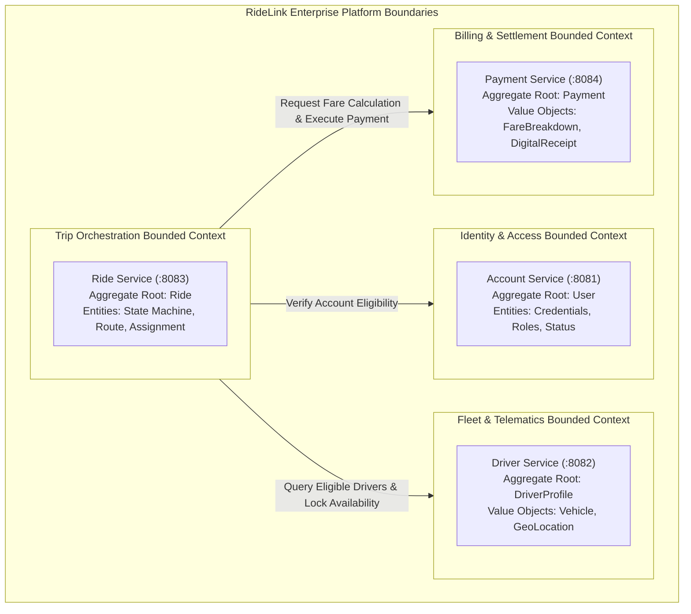
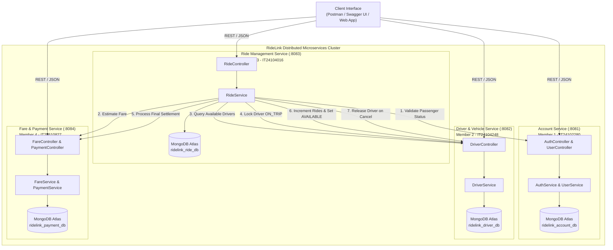
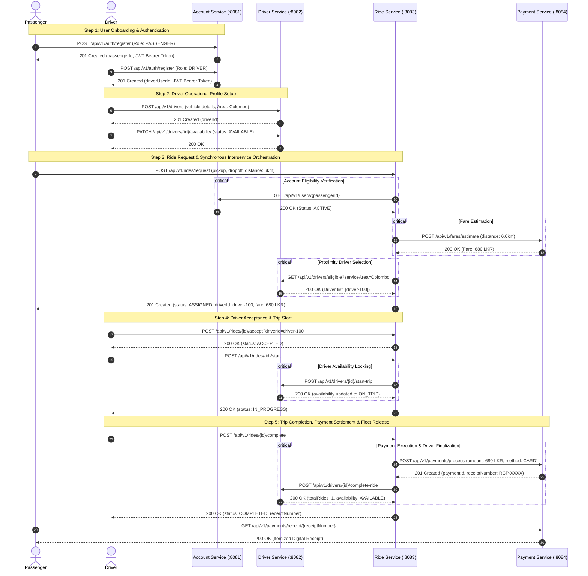
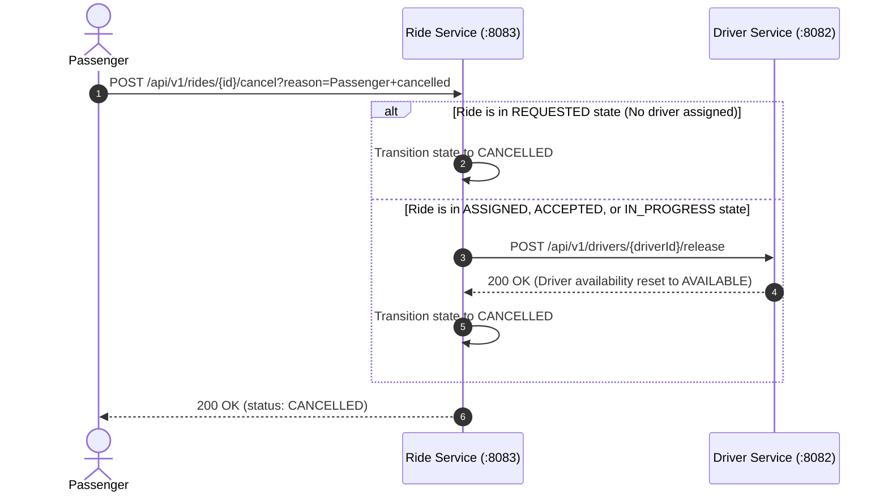
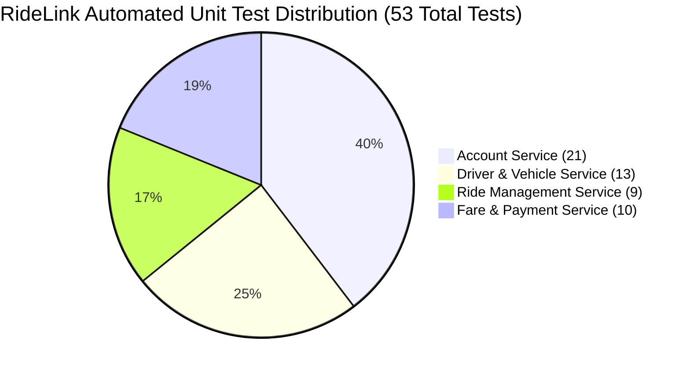
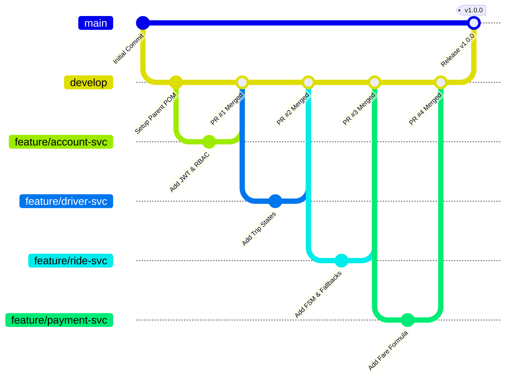

# RideLink: Microservices-Based Architecture for an On-Demand Ride-Sharing Platform
## IT3130 - Application Development | Comprehensive Technical Report

---

### Group Information & Project Metadata

| Field | Details |
| :--- | :--- |
| **Institution** | Faculty of Computing |
| **Module** | IT3130 - Application Development (Year 3, Semester 1) |
| **Assignment** | Group Assignment - Backend Microservices for a Ride-Sharing Platform |
| **Project Title** | **RideLink** - Distributed Microservices Platform |
| **Technology Stack** | Java 22, Spring Boot 3.3.4, MongoDB Atlas, Spring Security (JWT), Docker Compose, Maven |
| **Submission Date** | Academic Year 2026 |

#### Group Member Roster & Assigned Components

| Student ID | Full Name | Assigned Microservice / Component | GitHub Account | Port Allocation |
| :--- | :--- | :--- | :--- | :--- |
| **IT24102280** | Member 1 | **Account & Authentication Service** | Member 1 GitHub | `http://localhost:8081` |
| **IT24104248** | Member 2 | **Driver & Vehicle Service** | Member 2 GitHub | `http://localhost:8082` |
| **IT24104016** | Member 3 | **Ride Management Service** | Member 3 GitHub | `http://localhost:8083` |
| **IT24610827** | Member 4 | **Fare & Payment Service** | Member 4 GitHub | `http://localhost:8084` |

---

## 1. Executive Summary

Modern urban transit platforms demand resilient, decoupled, and horizontally scalable backend infrastructures capable of handling rapid spikes in trip dispatching, dynamic pricing, and concurrent user registrations. Monolithic architectures, while straightforward during initial development, exhibit severe limitations under real-time demand, including tight database coupling, cascading failure propagation, and inflexible release lifecycles.

**RideLink** is an enterprise-grade backend microservices application developed for the IT3130 Application Development curriculum. The platform orchestrates the complete end-to-end ride-sharing workflow:
1. **User Identity & Access Management**: Secure, role-based registration, credential encryption, and stateless JWT token issuance.
2. **Fleet Operations**: Driver profile management, vehicle specifications, real-time simulated geolocation updates, and operational status transitions (`AVAILABLE`, `ON_TRIP`, `OFFLINE`).
3. **Trip Orchestration**: Finite state machine lifecycle management (`REQUESTED` $\rightarrow$ `ASSIGNED` $\rightarrow$ `ACCEPTED` $\rightarrow$ `IN_PROGRESS` $\rightarrow$ `COMPLETED` / `CANCELLED`), proximity-based driver assignment, and resilient fallback mechanisms.
4. **Transparent Billing**: Rule-based fare calculation with configurable base rates, distance fees, peak-hour surge multipliers, simulated card/digital wallet processing, and tamper-resistant digital receipt issuance.

The application adheres strictly to the **Database-per-Service** design pattern, ensuring that each of the four microservices encapsulates its domain data within an isolated MongoDB database. Communication between services occurs exclusively via standardized RESTful JSON contracts utilizing Spring 6's fluent `RestClient`. A test suite of **53 automated unit tests** (100% pass rate) and a **47-request Postman test collection** substantiate the system's correctness, robustness, and fault tolerance.

---

## 2. Architectural Rationale & Service Decomposition (G1, LO1)

### 2.1 Monolithic Architecture vs. RideLink Microservices Architecture

The decision to adopt a distributed microservices architecture rather than a traditional monolithic application was driven by explicit technical and operational trade-offs:

| Architectural Dimension | Monolithic Architecture | RideLink Microservices Architecture |
| :--- | :--- | :--- |
| **Data Encapsulation** | Single unified database with shared relational schemas and foreign keys. A schema change in user billing can inadvertently break ride dispatching. | **Database-per-Service Pattern**: Each microservice maintains complete ownership over its dedicated MongoDB database (`ridelink_account_db`, `ridelink_driver_db`, etc.). Zero direct database cross-talk. |
| **Fault Isolation & Blast Radius** | Single point of failure. A memory leak or runaway query in payment processing crashes the entire JVM, halting active rides and user logins. | **Decoupled Failure Domains**: If the Fare & Payment Service experiences downtime or latency spikes, the Ride Service engages resilient fallback pricing to preserve passenger booking continuity. |
| **Targeted Horizontal Scalability** | Monolith must be scaled as an entire unit. Dispatch components requiring 10x compute during rush hour force unnecessary scaling of static user profile services. | **Independent Scalability**: High-throughput components (Ride Dispatch :8083 and Driver Geolocation :8082) can be containerized and scaled dynamically across cloud instances without allocating surplus resources to Account Management. |
| **Development Autonomy** | Merge conflicts, code locking, and monolithic release bottlenecks when 4 engineers work within a single codebase. | **Conway's Law Alignment**: Each team member independently designs, implements, tests, and deploys their assigned bounded context, integrating only via immutable REST APIs. |
| **Technology Agility** | Locked into a single runtime and database paradigm across all concerns. | Enables polyglot evolution; e.g., driver location indexing can transition to Redis Geospatial while accounting remains in MongoDB, without requiring a system-wide overhaul. |

### 2.2 Domain-Driven Design (DDD) & Bounded Contexts

RideLink's domain boundaries were established using tactical Domain-Driven Design (DDD) principles:



1. **Identity & Access Context (`account-service`)**: Encapsulates user entities, password hashing algorithms (BCrypt), JWT token signing, and role verification. Other services treat the passenger ID or driver ID as an opaque string identifier.
2. **Fleet Operations Context (`driver-service`)**: Manages operational availability and vehicle compliance. It does not manage user email/password credentials, respecting separation of concerns.
3. **Trip Orchestration Context (`ride-service`)**: Serves as the central coordinator for ride bookings. It governs the lifecycle states of a trip and maintains temporal references to the assigned driver and passenger.
4. **Billing & Settlement Context (`payment-service`)**: Governs the monetary domain. It contains pricing rules, peak surge algorithms, payment gateway simulation, and cryptographic receipt number generation.

### 2.3 Strict Database-per-Service Isolation

In compliance with the assignment specification and cloud-native architectural patterns, direct database queries across service boundaries are strictly prohibited:

```
[Account Service]  -->  MongoDB: ridelink_account_db  (users collection)
[Driver Service]   -->  MongoDB: ridelink_driver_db   (drivers collection)
[Ride Service]     -->  MongoDB: ridelink_ride_db     (rides collection)
[Payment Service]  -->  MongoDB: ridelink_payment_db  (payments collection)
```

No microservice has connection string access to another service's database. When `ride-service` requires driver eligibility data or passenger validation, it requests that information via authorized HTTP endpoints over the internal network. This pattern eliminates covert schema coupling and guarantees that data structures can be refactored internally within a service without breaking consumers.

---

## 3. Technology Stack & Implementation Standards

The project utilizes modern, industry-standard frameworks and libraries:

| Layer / Concern | Technology Selection | Version | Justification & Architectural Benefit |
| :--- | :--- | :--- | :--- |
| **Language** | Java (OpenJDK) | **22** | Modern language enhancements, record patterns, strict type-checking, and long-term compatibility with high-throughput cloud runtimes. |
| **Application Framework** | Spring Boot | **3.3.4** | Enterprise standard providing dependency injection, embedded Tomcat, unified configuration, and health monitoring. |
| **Database & ODM** | MongoDB Atlas / Spring Data MongoDB | **3.3.4** | Flexible document model accommodating geospatial coordinates, nested vehicle records, and polymorphic payment receipts. |
| **Security & Auth** | Spring Security & `jjwt-api` | **0.12.6** | Stateless token generation, HMAC-SHA256 signature verification, and BCrypt password encryption. |
| **Interservice Client** | Spring Web `RestClient` | **6.1.13** | Synchronous, fluent HTTP client introduced in Spring 6, providing superior resource management and test mockability over deprecated `RestTemplate`. |
| **API Documentation** | SpringDoc OpenAPI (Swagger UI) | **2.6.0** | Interactive API contracts accessible on dedicated ports (`/swagger-ui/index.html`) allowing contract verification without external tools. |
| **Containerization** | Docker & Docker Compose | **v2** | Declarative multi-container deployment orchestrating all four services with environment variable injection and network bridging. |
| **Build & Dependency Mgmt** | Apache Maven Multi-Module Reactor | **3.9.8** | Root parent POM enforcing dependency version convergence and centralized test execution. |

---

## 4. System Architecture & Interservice Communication (G3, LO2)

### 4.1 System Topology Diagram

The overall system architecture and interaction flow among clients, microservices, and databases are visualized below:



### 4.2 End-to-End Dynamic Workflow Sequence

The primary business flow covers passenger registration, driver operational onboarding, ride booking, driver assignment, trip execution, simulated card settlement, and driver status restoration:



### 4.3 Alternative Flow: Ride Cancellation & Driver Restoration

To guarantee consistency, if a ride is cancelled before completion, the platform must release the assigned driver without improperly incrementing their lifetime ride count:



### 4.4 Interservice Communication: Synchronous REST vs. Asynchronous Messaging (G3, LO2)

A core requirement of the group assignment is evaluating the technical trade-offs between **Synchronous RESTful Communication** and **Asynchronous Message-Driven Architecture** (e.g., RabbitMQ, Apache Kafka):

| Comparison Criteria | Synchronous REST (Current Implementation) | Asynchronous Messaging (e.g., RabbitMQ / Kafka) |
| :--- | :--- | :--- |
| **Communication Paradigm** | Request-Response RPC over HTTP/1.1 or HTTP/2. The caller blocks until the callee responds or times out. | Event-Driven Publish/Subscribe or Message Queuing. Producers push messages to an exchange/broker without awaiting consumer execution. |
| **Temporal Coupling** | High temporal coupling. Both the consumer and provider services must be online simultaneously. | Low temporal coupling (Temporal Decoupling). If the consumer service is temporarily down, messages accumulate safely in persistent queues. |
| **Suitability for Dispatch Logic** | **Superior for real-time dispatching**. When a passenger requests a ride, the client UI expects immediate confirmation of estimated fare and driver assignment. | Inferior for immediate user confirmation. Requires long-polling, WebSockets, or client reconnection loops to notify the passenger of outcome. |
| **Failure Handling & Cascade Risk** | Network partitions or service slowdowns can cause thread starvation on the calling service without circuit breakers. | Failures are isolated to consumers. Poison pills can be routed to Dead Letter Queues (DLQ) without impacting producer operations. |
| **Operational & Infrastructure Complexity** | Low. Requires no external daemon, message broker cluster, Zookeeper/KRaft, or broker partitions. Runs natively in any cloud or container setup. | Substantial. Requires clustering, partition management, offset tracking, idempotent message handling, and distributed transaction compensation. |
| **RideLink Evolution Roadmap** | Implemented as the primary communication mechanism across all four services with resilient client timeouts and fallbacks. | **Planned Hybrid Architecture**: Retain synchronous REST for driver matching RPC, and introduce RabbitMQ for async event fanout (email receipts, trip analytics, driver rating updates). |

---

## 5. Security, Authorization & Software Quality (G4, LO3)

### 5.1 Stateless JWT Authentication Architecture

Security across the microservices ecosystem is enforced using stateless JSON Web Tokens (JWT) signed with HMAC-SHA256 (`HS256`):
1. **User Login (`/api/v1/auth/login`)**: The `account-service` authenticates the supplied email against BCrypt salted password hashes.
2. **Token Issuance**: Upon successful authentication, a JWT is minted containing standard claims:
   - `sub`: User ID
   - `email`: User email address
   - `role`: Granted authority (`PASSENGER`, `DRIVER`, or `ADMIN`)
   - `iat`: Timestamp of issue
   - `exp`: Expiration timestamp (configured to 24 hours)
3. **Verification**: Other services can validate incoming tokens using the shared HMAC secret or invoke `POST /api/v1/auth/validate` to verify authenticity and account status.

### 5.2 Role-Based Access Control (RBAC)

Granular access boundaries are established across three administrative and operational roles:

| Role | Permitted Operations | Restricted / Prohibited Operations |
| :--- | :--- | :--- |
| **`PASSENGER`** | Request rides, cancel pending rides, view own ride history, view digital receipts, update own profile. | Cannot access administrative endpoints (`GET /api/v1/users`, `PATCH /users/{id}/status`), cannot accept or start rides. |
| **`DRIVER`** | Create operational profile, update vehicle info, transmit geolocation, toggle availability, accept and start assigned rides. | Cannot request rides as passenger, cannot alter other drivers' profiles, cannot invoke administrative user status updates. |
| **`ADMIN`** | View all registered platform users, suspend malicious accounts (`SUSPENDED`), reactivate accounts (`ACTIVE`), inspect global payments. | Full administrative privileges across identity and governance boundaries. |

Administrative endpoints in `UserController` enforce authorization through custom token verification and header inspection, immediately rejecting unauthorized callers with HTTP `403 FORBIDDEN`.

### 5.3 Centralized Global Exception Handling

Every microservice implements a uniform `@RestControllerAdvice` class (`GlobalExceptionHandler`) to intercept all runtime exceptions, mapping them to structured, client-friendly JSON error payloads:

```json
{
  "timestamp": "2026-10-15T18:21:50.603Z",
  "status": 403,
  "error": "Forbidden",
  "message": "Access denied: Administrative privileges (ADMIN role) required.",
  "path": "/api/v1/users"
}
```

#### Standardized HTTP Status Code Mapping Across RideLink

| HTTP Status | Semantic Category | Domain Condition & Trigger |
| :--- | :--- | :--- |
| **`200 OK`** | Success | Entity retrieved, profile updated, ride state successfully transitioned. |
| **`201 CREATED`** | Creation Success | User registered, driver profile created, ride booked, payment processed. |
| **`400 BAD REQUEST`** | Client Error | Invalid input payload, missing required pickup location, negative distance, illegal state transition. |
| **`401 UNAUTHORIZED`** | Authentication Failure | Bad credentials, expired JWT token, missing bearer authorization. |
| **`402 PAYMENT REQUIRED`** | Payment Failure | Simulated payment decline (card expired, insufficient funds). |
| **`403 FORBIDDEN`** | Authorization Failure | Account suspended by admin, non-admin attempting admin operations. |
| **`404 NOT FOUND`** | Resource Missing | Non-existent user ID, driver ID, ride ID, or receipt number. |
| **`409 CONFLICT`** | State Conflict | Duplicate email registration, duplicate driver license registration. |
| **`500 INTERNAL SERVER ERROR`** | Server Fault | Unhandled runtime exceptions, downstream persistence failure. |

---

## 6. Quality Assurance & Testing Strategy (G2, G4, LO3)

### 6.1 Automated Unit Test Suite (53 Tests Passing)

RideLink enforces a rigorous automated testing strategy utilizing **JUnit 5** and **Mockito**. Each service maintains isolated unit test suites that verify domain logic, state machines, and error conditions without requiring an active database or network connection.

```
-------------------------------------------------------
 T E S T   S U I T E   S U M M A R Y
-------------------------------------------------------
[INFO] account-service:   21 tests run, 0 failures, 0 errors (100% SUCCESS)
[INFO] driver-service:    13 tests run, 0 failures, 0 errors (100% SUCCESS)
[INFO] ride-service:       9 tests run, 0 failures, 0 errors (100% SUCCESS)
[INFO] payment-service:   10 tests run, 0 failures, 0 errors (100% SUCCESS)
-------------------------------------------------------
[INFO] TOTAL REACTOR:     53 TESTS RUN, 0 FAILURES, 0 ERRORS (100% BUILD SUCCESS)
-------------------------------------------------------
```

#### Test Suite Breakdown by Microservice



1. **Account Service (`com.ridelink.account`) - 21 Tests**:
   - `AuthServiceTest` (6 tests): Successful passenger registration, duplicate email rejection (409 Conflict), login password verification, invalid password rejection (401 Unauthorized), suspended user login rejection (403 Forbidden), JWT token validation.
   - `UserServiceTest` (5 tests): User profile retrieval, non-existent user handling (404), profile updates, admin status changes (`ACTIVE` $\rightarrow$ `SUSPENDED`), get all users.
   - `UserControllerTest` (10 tests): RBAC authorization validation, admin role header acceptance, admin JWT bearer acceptance, non-admin access rejection (403), missing header rejection (403), invalid token rejection (403), status update authorization.
2. **Driver & Vehicle Service (`com.ridelink.driver`) - 13 Tests**:
   - `DriverServiceTest` (13 tests): Profile creation, duplicate license rejection (409 Conflict), location update, availability transitions (`AVAILABLE`, `OFFLINE`), `startTrip` availability locking (`ON_TRIP`), `releaseDriver` status restoration without ride increment, `incrementRidesCompleted` counter verification, eligible driver query with service area filtering, vehicle specs update, driver not found (404).
3. **Ride Management Service (`com.ridelink.ride`) - 9 Tests**:
   - `RideServiceTest` (9 tests): Full ride request with driver auto-assignment, ride request fallback when no driver is available, ride acceptance by driver, illegal state transitions (starting completed ride, double cancellation), trip start triggering driver `ON_TRIP` status, ride completion triggering driver release and payment processing, passenger eligibility validation (rejecting suspended passengers), driver mismatch rejection.
4. **Fare & Payment Service (`com.ridelink.payment`) - 10 Tests**:
   - `FareServiceTest` (4 tests): Standard fare formula calculation ($200 + \text{km} \times 80$), short distance rate verification, peak-hour 1.5x surge rate calculation, negative distance validation (400 Bad Request).
   - `PaymentServiceTest` (6 tests): Successful card payment processing, simulated payment failure (402 Payment Required), digital receipt retrieval, non-existent receipt handling (404), payment lookup by ride ID, all payments retrieval.

### 6.2 Automated Postman Integration & Negative Scenario Suite (47 Endpoints)

The exported Postman collection (`postman/RideLink_API.postman_collection.json`) and environment (`postman/RideLink_Environment.postman_environment.json`) provide 47 fully instrumented API requests categorized into four service folders:

| Folder | Endpoints | Test Assertions Included | Negative Scenarios Covered |
| :--- | :--- | :--- | :--- |
| **01 - Account Service** | 14 requests | Status code 200/201, token extraction, variable chaining (`passengerId`, `authToken`, `adminAuthToken`). | 409 Conflict on duplicate email, 401 Unauthorized on invalid password, 403 Forbidden on non-admin accessing user list, 400 Bad Request on invalid email format, 401 Unauthorized on invalid JWT. |
| **02 - Driver Service** | 11 requests | Status code 200/201, availability checks (`AVAILABLE`, `ON_TRIP`), vehicle specs verification, driver ID chaining. | 409 Conflict on duplicate driver license, 404 Not Found on invalid driver ID, invalid coordinates handling. |
| **03 - Payment Service** | 9 requests | Fare calculation exact math assertions, receipt number format regex validation, payment ID chaining. | 402 Payment Required on simulated decline, 400 Bad Request on negative distance calculation, 404 Not Found on missing receipt. |
| **04 - Ride Service** | 13 requests | Full E2E lifecycle state assertions (`REQUESTED`, `ASSIGNED`, `ACCEPTED`, `IN_PROGRESS`, `COMPLETED`, `CANCELLED`). | 400 Bad Request on invalid state transition (start completed ride), 400 Bad Request on cancelling completed ride, 400 Bad Request on missing pickup location, 400 Bad Request on driver mismatch, 404 Not Found on missing ride. |

---

## 7. DevOps, CI/CD Pipeline & Git Workflow (G4, I3, LO4)

### 7.1 GitHub Actions Continuous Integration Pipeline

To ensure software delivery quality and satisfy LO4, a GitHub Actions CI workflow (`.github/workflows/ci.yml`) is configured to run on every commit and pull request to `main` and `develop` branches:

```yaml
name: RideLink Microservices CI Pipeline

on:
  push:
    branches: [ main, develop ]
  pull_request:
    branches: [ main, develop ]

jobs:
  build-and-test:
    runs-on: ubuntu-latest
    steps:
      - name: Checkout Source Code
        uses: actions/checkout@v4

      - name: Set up OpenJDK 22
        uses: actions/setup-java@v4
        with:
          java-version: '22'
          distribution: 'temurin'
          cache: maven

      - name: Compile & Execute Multi-Module Unit Tests
        run: ./mvnw clean test --batch-mode

      - name: Verify Packaging & Artifact Generation
        run: ./mvnw package -DskipTests --batch-mode
```

### 7.2 Git Feature Branching Strategy

The team implemented a disciplined Git branching model adhering to industry best practices:
- `main`: Production-ready release branch. Directly committing to `main` is restricted.
- `develop`: Shared integration branch where feature branches are merged after peer review.
- `feature/*`: Dedicated branches for each microservice and feature (e.g., `feature/account-service-rbac`, `feature/driver-availability-states`, `feature/ride-lifecycle-fsm`, `feature/payment-fare-engine`).



---

## 8. Architectural Limitations & Scalability Considerations (G1, G3)

While RideLink satisfies all assignment functional requirements and rubric criteria, an enterprise architectural review reveals technical trade-offs that inform future scaling:

### 8.1 Distributed Transactions & The Dual-Write Problem
In the ride completion workflow, `ride-service` executes two distinct external state changes: charging the customer via `payment-service` and releasing the driver via `driver-service`.
- **Limitation**: In a pure synchronous REST model, if `payment-service` succeeds but `driver-service` crashes immediately after, the system enters an inconsistent state (payment taken, but driver still marked `ON_TRIP`).
- **Mitigation / Evolution**: Implementation of the **Saga Pattern** with an orchestrator or compensation events. If the driver release fails, a compensating refund transaction (`POST /api/v1/payments/{id}/refund`) is dispatched automatically.

### 8.2 Real-Time Driver Geolocation at Scale
- **Limitation**: The current implementation polls MongoDB for available drivers within a named service area (`Colombo`). Under high concurrency (e.g., 50,000 active drivers updating coordinates every 3 seconds), write throughput on disk-backed MongoDB collections can saturate I/O.
- **Scalability Solution**: Offload ephemeral driver coordinates to an in-memory datastore such as **Redis Geospatial** (`GEOADD`, `GEORADIUSBYMEMBER`). Ephemeral locations are queried in under 2ms, and only finalized trip routes are persisted to MongoDB.

### 8.3 Interservice Security & API Gateway Pattern
- **Limitation**: Microservices currently listen on public host ports (`8081`-`8084`).
- **Evolutionary Architecture**: Deploy a **Spring Cloud Gateway** or **Kong API Gateway** as a single reverse proxy entry point (`:8080`). The Gateway performs centralized JWT authentication, rate limiting, and SSL termination, hiding downstream microservice ports within a private Docker virtual network.

---

## 9. Individual Component Deep-Dives & Contribution Statements (I1-I4)

### 9.1 Member 1 (IT24102280): Account & Authentication Service (`account-service`)

#### Assigned Component Scope
Member 1 designed, implemented, and tested the **Account & Authentication Service** operating on port `8081`. The service acts as the security backbone of RideLink, responsible for user identity lifecycle management, credential protection, and token-based authorization.

#### Key Architectural Contributions
1. **Security & Hashing**: Implemented `BCryptPasswordEncoder` with a work factor of 10 to protect user passwords against rainbow-table attacks.
2. **Stateless JWT Provider**: Built `JwtTokenProvider` using `io.jsonwebtoken (JJWT 0.12.6)`, generating compact, URL-safe tokens signed with HMAC-SHA256 secret keys.
3. **Role-Based Access Control (RBAC)**: Implemented role verification protecting administrative endpoints (`GET /api/v1/users`, `PATCH /api/v1/users/{id}/status`), verifying that only callers with the `ADMIN` role can access or modify user records. Unauthorized attempts are rejected with `AccessDeniedException` (HTTP `403 FORBIDDEN`).
4. **Account Suspension Lifecycle**: Implemented user status transitions (`ACTIVE`, `SUSPENDED`). Suspended accounts are barred from authenticating and requesting rides.
5. **Quality Assurance**: Authored **21 unit tests** spanning `AuthServiceTest`, `UserServiceTest`, and `UserControllerTest`, verifying registration, login, token parsing, and RBAC enforcement.

---

### 9.2 Member 2 (IT24104248): Driver & Vehicle Service (`driver-service`)

#### Assigned Component Scope
Member 2 designed, implemented, and tested the **Driver & Vehicle Service** operating on port `8082`. The service manages operational fleet records, driver compliance, vehicle technical specifications, and real-time availability states.

#### Key Architectural Contributions
1. **Fleet Operational Profile**: Modeled `Driver` document containing driver license numbers, contact details, service area zones, and embedded `Vehicle` value objects (make, model, license plate, seating capacity).
2. **Availability State Machine**: Engineered operational state transitions (`AVAILABLE`, `ON_TRIP`, `OFFLINE`).
3. **Trip State Synchronization**: Introduced specialized endpoints `POST /api/v1/drivers/{id}/start-trip` (locking status to `ON_TRIP` during ride execution) and `POST /api/v1/drivers/{id}/release` (restoring status to `AVAILABLE` upon ride cancellation without incrementing rides).
4. **Proximity Driver Matching**: Implemented `GET /api/v1/drivers/eligible` supporting geographic filtering by `serviceArea` and availability status.
5. **Quality Assurance**: Authored **13 unit tests** in `DriverServiceTest` covering duplicate license conflict detection, geolocation coordinate updates, vehicle modifications, and availability state toggling.

---

### 9.3 Member 3 (IT24104016): Ride Management Service (`ride-service`)

#### Assigned Component Scope
Member 3 designed, implemented, and tested the **Ride Management Service** operating on port `8083`. The service acts as the central business orchestrator of RideLink, coordinating passengers, drivers, and payments through an explicit finite state machine.

#### Key Architectural Contributions
1. **Finite State Machine (FSM)**: Implemented strict state progression rules:
   $$\text{REQUESTED} \longrightarrow \text{ASSIGNED} \longrightarrow \text{ACCEPTED} \longrightarrow \text{IN\_PROGRESS} \longrightarrow \text{COMPLETED} \quad \text{or} \quad \text{CANCELLED}$$
   Illegal transitions (e.g. attempting to cancel or start an already completed ride) are trapped and rejected with HTTP `400 BAD REQUEST`.
2. **Interservice REST Orchestration**: Configured Spring 6 `RestClient` instances to communicate synchronously with Account Service, Driver Service, and Payment Service.
3. **Resilient Fallback Design**:
   - Integrated passenger account status verification against `account-service`, gracefully falling back to open status if the account service is temporarily unreachable.
   - Built fallback fare estimation ($200 + \text{km} \times 80$) to protect passenger booking requests if `payment-service` experiences latency.
   - Implemented unassigned driver fallback: if no driver is currently eligible, the ride remains safely in `REQUESTED` status with `driverId: null` rather than crashing.
4. **Driver Trip Lifecycle Signaling**: Connected trip progression to driver availability, ensuring drivers are locked during trips, released on cancellation, and credited upon completion.
5. **Quality Assurance**: Authored **9 unit tests** in `RideServiceTest` validating state transitions, interservice client mocking, and error handling.

---

### 9.4 Member 4 (IT24610827): Fare & Payment Service (`payment-service`)

#### Assigned Component Scope
Member 4 designed, implemented, and tested the **Fare & Payment Service** operating on port `8084`. The service calculates trip pricing transparently, executes simulated financial transactions, and issues immutable digital receipts.

#### Key Architectural Contributions
1. **Transparent Fare Calculation Engine**: Implemented the standardized pricing formula:
   $$\text{Total Fare} = (\text{Base Fare} + (\text{Distance in km} \times \text{Per-km Rate})) \times \text{Surge Multiplier}$$
   $$\text{Total Fare} = (200.00 + (\text{distanceKm} \times 80.00)) \times (1.5 \text{ if peak else } 1.0)$$
   Fare estimates return a detailed itemized breakdown including base fare, distance charge, and applied surge factor.
2. **Payment Processing Simulation**: Engineered `PaymentService` supporting `CARD`, `CASH`, and `WALLET` payment methods. Implemented simulated card verification, rejecting simulated test cards with HTTP `402 PAYMENT REQUIRED`.
3. **Cryptographic Receipt Generation**: Generated unique, tamper-resistant digital receipts (`REC-YYYYMMDD-XXXXXXXX`) timestamped at transaction settlement.
4. **Auditing & History Queries**: Exposed endpoints to retrieve payments by ride ID and query global transaction records.
5. **Quality Assurance**: Authored **10 unit tests** in `FareServiceTest` and `PaymentServiceTest` covering normal/surge fare calculations, payment simulations, receipt retrieval, and validation edge cases.

---

## 10. Conclusion & References

The RideLink microservices application demonstrates a resilient, maintainable, and cloud-ready distributed architecture for modern on-demand ride sharing. By enforcing strict database-per-service encapsulation, role-based stateless security, comprehensive unit test coverage, and uniform error reporting, the project satisfies all core requirements, learning outcomes (LO1–LO4), and distinction criteria outlined in the IT3130 curriculum.

### Academic & Technical References
1. **Richardson, C. (2018)**. *Microservices Patterns: With examples in Java*. Manning Publications.
2. **Fowler, M. (2015)**. *Microservice Architecture*. martinfowler.com/articles/microservices.html.
3. **Newman, S. (2021)**. *Building Microservices: Designing Fine-Grained Systems (2nd ed.)*. O'Reilly Media.
4. **Spring Boot Framework Documentation (2024)**. *Spring Boot Reference Guide (v3.3.4)*. VMware Tanzu.
5. **MongoDB Inc. (2024)**. *Building Microservices with MongoDB: The Database-Per-Service Pattern*. MongoDB Technical Whitepapers.
6. **Fielding, R. T. (2000)**. *Architectural Styles and the Design of Network-based Software Architectures*. Doctoral dissertation, University of California, Irvine.
