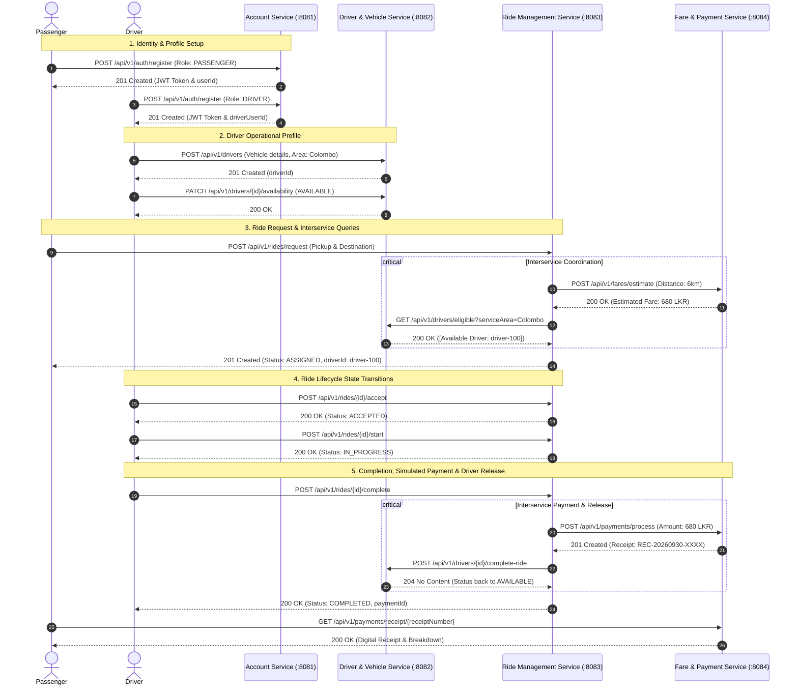

# RideLink - Architecture & Sequence Specifications

**Module**: IT3130 - Application Development  
**Platform**: RideLink Backend Microservices for a Ride-Sharing Platform  

---

## 1. System Architecture Diagram

Each service maintains strict data encapsulation following the **Database-per-Service** pattern. No service directly queries another service's database.

```mermaid
graph TD
    Client["Swagger UI / Postman Client"]

    subgraph Boundaries ["RideLink Microservices Ecosystem"]
        subgraph S1 ["Account Service :8081 (Member 1 - IT24102280)"]
            AC_Ctrl["AuthController & UserController"]
            AC_Svc["AuthService & UserService"]
            AC_DB[("MongoDB: ridelink_account_db\n(users collection)")]
            AC_Ctrl --> AC_Svc --> AC_DB
        end

        subgraph S2 ["Driver & Vehicle Service :8082 (Member 2 - IT24104248)"]
            DR_Ctrl["DriverController"]
            DR_Svc["DriverService"]
            DR_DB[("MongoDB: ridelink_driver_db\n(drivers collection)")]
            DR_Ctrl --> DR_Svc --> DR_DB
        end

        subgraph S3 ["Ride Management Service :8083 (Member 3 - IT24104016)"]
            RD_Ctrl["RideController"]
            RD_Svc["RideService"]
            RD_DB[("MongoDB: ridelink_ride_db\n(rides collection)")]
            RD_Ctrl --> RD_Svc --> RD_DB
        end

        subgraph S4 ["Fare & Payment Service :8084 (Member 4 - IT24610827)"]
            PM_Ctrl["FareController & PaymentController"]
            PM_Svc["FareService & PaymentService"]
            PM_DB[("MongoDB: ridelink_payment_db\n(payments collection)")]
            PM_Ctrl --> PM_Svc --> PM_DB
        end
    end

    %% Client Invocations
    Client -->|REST JSON| AC_Ctrl
    Client -->|REST JSON| DR_Ctrl
    Client -->|REST JSON| RD_Ctrl
    Client -->|REST JSON| PM_Ctrl

    %% Interservice Synchronous REST Communication
    RD_Svc -->|GET /api/v1/drivers/eligible| DR_Ctrl
    RD_Svc -->|POST /api/v1/fares/estimate| PM_Ctrl
    RD_Svc -->|POST /api/v1/payments/process| PM_Ctrl
    RD_Svc -->|POST /api/v1/drivers/{id}/complete-ride| DR_Ctrl
    AC_Svc -.->|Token Validation| RD_Svc
```

---

## 2. End-to-End Workflow Sequence Diagram

This diagram demonstrates the complete ride-booking lifecycle, interservice coordination, state transitions, and simulated payment processing.



---

## 3. Microservices vs. Monolithic Architecture Comparison

| Dimension | Monolithic Architecture | RideLink Microservices Architecture |
| :--- | :--- | :--- |
| **Data Boundaries** | Single shared database; tables coupled through foreign keys. | **Database-per-Service**: Each service owns its MongoDB database (`ridelink_account_db`, etc.). |
| **Team Autonomy** | Changes to payments or dispatch affect entire codebase and deployment. | **High Autonomy**: 4 independent services owned by 4 developers with distinct repositories/modules. |
| **Fault Isolation** | High failure risk: A crash or memory leak in payment processing crashes all ride requests. | **Fault Tolerance**: If Fare/Payment service experiences downtime, Ride Service falls back to resilient estimation. |
| **Scalability** | Must scale entire monolith even if only ride dispatch is high traffic. | **Targeted Scaling**: Ride Service and Driver Service can scale horizontally to handle peak-hour spikes independently. |
| **Operational Complexity** | Low deployment complexity (single JAR), easy local runs. | Requires service port management, distributed tracing, network resilience, and CI automation. |

---

## 4. Interservice Communication Justification

- **Synchronous REST (Implemented)**:
  - **Rationale**: Immediate response is needed when matching a driver or requesting a fare estimate during ride creation. HTTP/REST with standard JSON payloads is lightweight, human-readable, and supported natively across Spring Web (`RestClient`).
  - **Error Handling & Fallbacks**: If downstream services are unreachable or report timeouts, default calculation strategies ensure passenger requests are not stalled ungracefully.
- **Asynchronous Messaging Comparison (e.g. RabbitMQ/Kafka)**:
  - **Trade-off Analysis**: Highly suitable for background event fanout (e.g., sending email receipts, analytics, audit logs), but introduces broker infrastructure overhead (queue management, dead-letter exchanges) for request-reply RPC workflows where an immediate synchronous response is required by the client.
